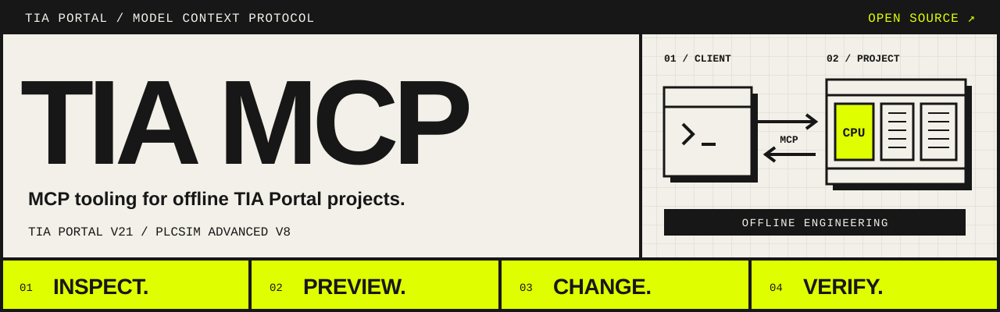
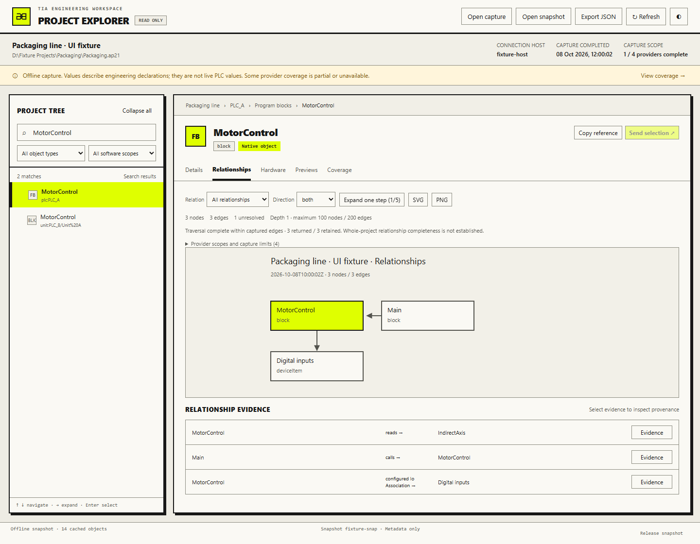
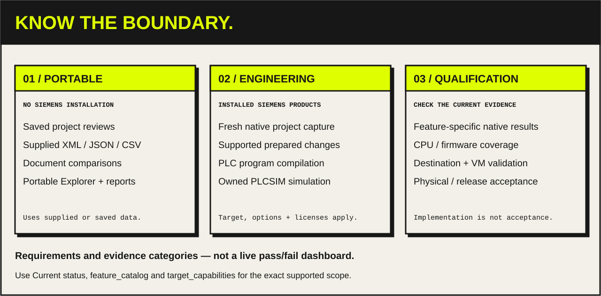

# TIA MCP



[](https://github.com/Sparkz400/TIA_MCP/actions/workflows/offline.yml)
[](https://github.com/Sparkz400/TIA_MCP/actions/workflows/playwright.yml)

A Windows MCP server that lets an MCP client inspect and make recoverable changes
to offline **TIA Portal V21** projects, with simulation through **PLCSIM Advanced V8**.
A .NET 10 host connects to isolated .NET Framework 4.8 workers. Siemens assemblies
are loaded from your installed products and are not redistributed.

> **Status and safety:** pre-1.0 and under active development. Offline tooling is
> validated in CI; live TIA Portal and PLCSIM runtime qualification is incomplete
> (see [Current status](docs/STATUS.md)). Use it only with offline projects, copies,
> scratch projects and simulators you own, never with production PLCs or plants.
> Independent project, not affiliated with Siemens ([trademarks](#license)).

[Documentation](docs/README.md) · [Wiki](https://github.com/Sparkz400/TIA_MCP/wiki) ·
[Current status](docs/STATUS.md) · [Remaining work](docs/TODO.md) ·
[Discussions](https://github.com/Sparkz400/TIA_MCP/discussions) · [Contributing](CONTRIBUTING.md)

<!-- Demo: add docs/assets/demo.gif here (about 30 s: discover a session, find a
     block's callers, preview a change) and reference it as the first image. -->

## What you can ask

With the server connected, ask your MCP client in plain language:

- *"List the open TIA Portal sessions and open the packaging-line project."*
  → `tia_discover`, `project_open`
- *"Which blocks call `MotorControl`, and what is affected if I change its interface?"*
  → `call_graph`, `change_impact`
- *"Prepare that change, show me the preview, then apply it with a checkpoint."*
  → `change_prepare`, `change_apply`, `change_restore` if it goes wrong
- *"Create a PLCSIM instance and test that `Motor_On` follows `Start`."*
  → `sim_create`, `sim_test`
- *"Give me a health report of this project."* → `project_health_report`

Ask `feature_catalog` and `target_capabilities` what your target supports.

## Explore a project

Browse project objects, follow block relationships and inspect the evidence behind
each connection in the [Project Explorer](docs/guides/project-explorer.md).

[](docs/assets/project-explorer.png)

*Actual Explorer UI with synthetic sample data. This offline snapshot is not a
live TIA Portal session or evidence of native runtime qualification.*

[Architecture](docs/guides/architecture.md) ·
[Engineering workflow](docs/guides/engineering-workflows.md) ·
[Visual assets](docs/assets/README.md)

## Prerequisites

For the full engineering build and MCP server:

- Windows with TIA Portal V21 and Openness installed and configured for your user.
- PLCSIM Advanced V8 installed for the simulator adapter; running simulation also
  requires a usable license and a supported CPU/firmware combination.
- .NET 10 SDK (selected by `global.json`) and .NET Framework 4.8 reference assemblies.
- PowerShell 7, Python 3.13 and Node.js 24 for the development checks.

Use your normal authorized Windows engineering account. See
[environment diagnostics](docs/guides/environment-diagnostics.md) and
[Openness registration](docs/guides/openness-application-registration.md) for setup.
Without Siemens software you can still use the portable workflows and run the
offline checks, as described below.

### Working without any Siemens installation

The Host and portable libraries can be built on their own:

```powershell
dotnet build src/TiaMcp.Host/TiaMcp.Host.csproj -c Release --artifacts-path artifacts/host-only
```

Point a stdio MCP client at the resulting
`artifacts/host-only/bin/TiaMcp.Host/release/TiaMcp.Host.exe`, using an absolute
path. Set `--artifacts` to the directory where the Host should retain uploaded
documents and reports. Add `--no-native-workers` to refuse Siemens calls before
worker startup. A regular development Host otherwise starts workers on demand.

For a portable Windows package, run `./scripts/Package.ps1 -Offline`. This builds
only the Host and portable libraries, creates a ZIP with hashes and dependency
notices, and writes an external MCP configuration beside the bundle. The portable
binary always disables native workers, including direct launches. It requires the
.NET 10 ASP.NET Core shared runtime; Git is separately installed and optional.
See [portable deployment and validation](docs/guides/deployment.md#portable-package-without-siemens)
for configuration, relocation and the package test command.

Already available in this setup:

- Upload and hash-check supplied documents with `artifact_upload_begin`,
  `artifact_upload_chunk` and `artifact_upload_commit`.
- Import saved project reviews, resolve captured diagnostic instances/signals,
  export offline watch plans and analyze supplied JSON/CSV measurements through
  the [offline diagnostic workflow](docs/guides/trace-diagnostics.md).
- Inspect and compare supplied OPC UA NodeSets and explicit dependencies through
  the [offline OPC UA workflow](docs/reference/opc-ua-workflow.md).
- Inspect supplied AutomationML/CAEX 2.15 and 3.0, compare declared structure and
  review conservative topology impacts through the [offline CAx workflow](docs/reference/automationml-workflow.md).
- Inspect and compare supplied GRAPH XML, download exact source/reports/HTML and
  attach reports locally in Explorer through the [offline GRAPH workflow](docs/reference/graph-host-workflow.md).
- Review supplied translation workbooks and prepare offline candidates through
  the [translation workflow](docs/reference/translation-host-workflow.md).
- Review and commit uploaded raw documents to independent local Git revisions,
  inspect history and export exact revisions through the [offline VCI Git workflow](docs/reference/vci-host-workflow.md).
  This additionally requires the explicit `--git-executable` Host option.
  Supplied [package mappings and three-way conflicts](docs/reference/vci-package-workflow.md) can also be reviewed offline.
- Review [detached Add-In selections](docs/reference/addin-selections.md) against
  saved project reviews; native companion delivery remains open.
- Compare [supplied Project Server observations](docs/reference/multiuser-observations.md),
  retaining session/lock/marking differences and coverage gaps without connecting
  to a server. Native collaboration workflows remain open.
- Compare Teamcenter item/revision/dataset metadata through the
  [supplied-review workflow](docs/reference/teamcenter-observations.md); it does not
  verify native cache contents or grant checkout ownership.
- Use the local Windows [protected credential commands](docs/reference/protected-credentials.md)
  with hidden console input or an explicit stdin pipe; they do not configure a PLC or server.
- Run the portable development checks below against retained or synthetic
  fixtures, and audit which historical evidence files are unavailable.

Opening TIA projects, exporting fresh native documents, compiling PLC programs,
applying native changes and running PLC simulations still require their Siemens
products. The full solution build, `--diagnose` and the discovery smoke check
below belong to that engineering environment. See the
[complete implementation queue without Siemens](docs/plans/offline-execution-20261016.md)
for what is delivered, what remains implementable here and what needs native testing.

## Quick start

From the repository root on an engineering workstation:

```powershell
.\scripts\Probe-Environment.ps1
.\scripts\Build.ps1
.\scripts\Test.ps1 -SkipBuild
```

Configure your MCP client's stdio server using your actual checkout path:

```json
{
  "mcpServers": {
    "tia-v21": {
      "command": "C:\\path\\to\\TIA_MCP\\src\\TiaMcp.Host\\bin\\Debug\\net10.0-windows\\TiaMcp.Host.exe",
      "args": ["--timeout-seconds", "300"]
    }
  }
}
```

### Example: discover available TIA sessions

With the server connected, ask your MCP client:

> Use `tia_discover` to list the available TIA Portal sessions.

For a command-line discovery smoke check after building:

```powershell
python .\scripts\smoke_mcp.py
```

The default smoke check performs discovery. See
[engineering workflows](docs/guides/engineering-workflows.md) for the
prepare → preview → checkpoint → apply → verify workflow, and
[deployment](docs/guides/deployment.md) for packaging, launch options and SSH access.

## What it supports



- **Inspection and tracing:** project inventory, blocks, types, tags, references,
  call graphs and change-impact queries.
- **Project explorer and reviews:** a read-only browser, portable exports,
  persistent snapshots, comparisons, searches and health reports.
- **Recoverable engineering:** supported block, tag, hardware, technology-object
  and library changes, with checkpoints and journals.
- **Simulation and block testing:** owned PLCSIM Advanced instances, simulated
  I/O and test assertions.

Support varies by target and feature. Use `feature_catalog` for implementation
scope and `target_capabilities` for the selected target. This is an evolving
prototype; offline tests, native compilation and runtime qualification are
separate claims. Consult [current status](docs/STATUS.md),
[engineering coverage](docs/reference/engineering-coverage.md) and the
[runtime qualification ledger](docs/plans/runtime-proof-todo.md).

Changes can partially fail and require recovery from their checkpoint; they are
not transactions across Siemens calls. The public simulation workflow operates
on adapter-owned simulator instances and does not expose physical PLC download,
force or CPU control. Keep project exports and credentials private.

## Development checks

On Windows with PowerShell 7, .NET 10, Python 3.13 and Node.js 24:

```powershell
# Contracts, Python harnesses, explorer unit tests and managed .NET suites.
# Does not require or start Siemens software.
python -m venv .venv
.\.venv\Scripts\Activate.ps1
python -m pip install -r scripts/requirements-test.txt
.\scripts\Test-Offline.ps1

# Browser tests use the dependencies pinned in package-lock.json.
npm ci
npx playwright install chromium
npm run test:explorer:browser
```

GitHub Actions reports Python, managed .NET and browser validation separately.
Siemens-dependent checks run on a configured engineering workstation; see
[Contributing](CONTRIBUTING.md#validation). Generated reports, scratch projects
and screenshots belong in ignored `artifacts/` and `output/` directories.

## Documentation

- [Documentation index](docs/README.md)
- [Project explorer](docs/guides/project-explorer.md) and [persistent reviews](docs/guides/project-reviews.md)
- [Simulation](docs/guides/simulation.md) and [block testing](docs/guides/block-testing.md)
- [Library management](docs/guides/library-management.md) and [HMI integration](docs/guides/hmi-integration.md)
- [Detailed previous README and verification history](docs/history/readme-before-repository-cleanup-20261015.md)
- [Security reporting](SECURITY.md)

## License

TIA MCP is developed by Nico Schürmann ([@Sparkz400](https://github.com/Sparkz400)).
Copyright 2026 Nico Schürmann.

TIA MCP's original code and documentation are licensed under
[Apache License 2.0](LICENSE); redistributions must keep the attribution in
[NOTICE](NOTICE). Third-party material retains its own license;
see [the OPC Foundation schema attribution](third-party/opcua/README.md).
Siemens products and SDK assemblies remain subject to their own license terms.
Provided "as is", without warranty.

Siemens, TIA Portal, SIMATIC, STEP 7, WinCC and PLCSIM are trademarks of Siemens AG.
This project is independent and not affiliated with, endorsed or supported by Siemens.
OPC UA is a trademark of the OPC Foundation.
