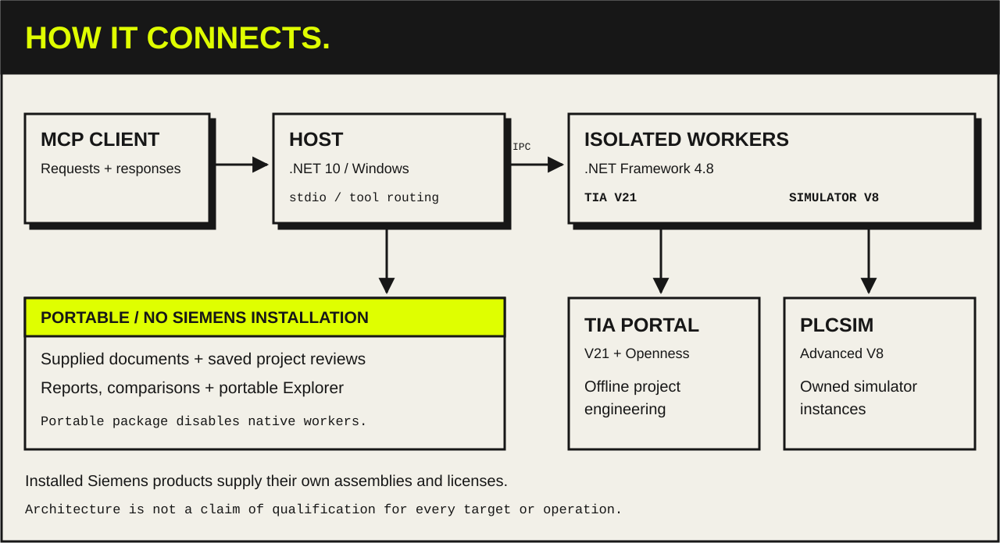

# System architecture

The MCP client sends requests to the Windows .NET 10 Host over stdio. The Host
routes supported native operations to isolated .NET Framework 4.8 workers:
`TiaMcp.Openness.V21` for TIA Portal and `TiaMcp.Simulator.V8` for PLCSIM Advanced.
Siemens assemblies come from the installed products; the repository does not
redistribute them. Native operations depend on the installed options, supported
targets, project state and usable licenses.

Portable workflows inspect supplied documents and saved project reviews through
the Host and portable libraries. The portable package disables native workers.
The read-only Project Explorer can display an exported snapshot in a standalone
HTML file without a network connection; a compatible MCP Apps host can also
provide read-only requests to the connected server.

This diagram shows component boundaries. It does not establish support or
qualification for every operation, target or environment. Consult the
[current status](../STATUS.md), `feature_catalog` and `target_capabilities` for
the applicable scope and evidence.

- [Deployment and portable packaging](deployment.md)
- [Project Explorer, transport and snapshot boundaries](project-explorer.md)
- [Prepared engineering changes and recovery](engineering-workflows.md)
