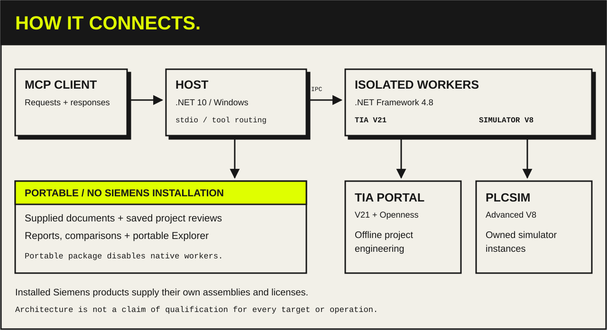

# System architecture

The MCP client sends requests to the Windows .NET 10 Host over stdio. The Host
routes supported native operations to isolated .NET Framework 4.8 workers:
`TiaMcp.Openness.V21` for TIA Portal and `TiaMcp.Simulator.V8` for PLCSIM Advanced.
A Host started with `--tia-version 19` runs the read-only `TiaMcp.Openness.V19` instead of the V21 worker and
advertises only its read tools ([V19 adapter](../reference/tia-v19-adapter.md)); one Host serves one TIA version.
Siemens assemblies come from the installed products; the repository does not
redistribute them. Native operations depend on the installed options, supported
targets, project state and usable licenses.

The Host retains its engineering worker and that worker's Openness session across
tool calls. Normal startup reads the selected executable's saved Siemens AllowList
identity and reports missing/stale registration without changing it. Only explicit
[setup or an approved update](openness-application-registration.md#setup-and-approved-updates)
registers the installed executable. Separate native helper programs have separate
identities; they are not covered by the worker's registration or capability qualification.

Portable workflows inspect supplied documents and saved project reviews through
the Host and portable libraries. The portable package disables native workers.
The read-only Project Explorer can display an exported snapshot in a standalone
HTML file without a network connection; a compatible MCP Apps host can also
provide read-only requests to the connected server.

This diagram shows component boundaries. It does not establish support or
qualification for every operation, target or environment. Consult the
[current status](../STATUS.md), `feature_catalog` and `target_capabilities` for
the applicable scope and evidence.

- [Deployment and portable packaging](deployment.md)
- [Project Explorer, transport and snapshot boundaries](project-explorer.md)
- [Prepared engineering changes and recovery](engineering-workflows.md)
