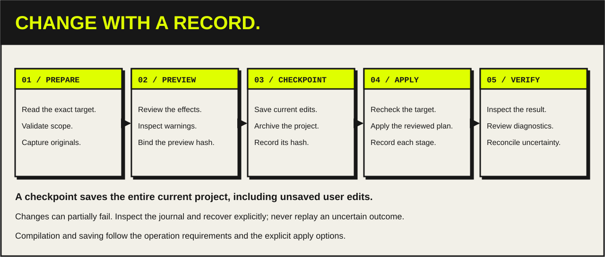

# Offline engineering changes



The V21 worker implements prepared changes for standard blocks, data types, tag tables, selected hardware and network configuration, technology objects, and a separate safety-block XML import path. These are offline engineering operations. They do not download, force values, change a CPU state, or accept passwords. Runtime and simulator tools are separate.

The installed Siemens API, CPU, firmware, options, project state, protection and licenses still determine whether an individual operation succeeds. A supported code path is not evidence that every hardware catalog item, technology object or safety configuration has been qualified. Native integration results are saved under `artifacts/`.

## Prepare, apply, inspect

`change_prepare` accepts `projectName`, an optional exact `plcPath` from inventory, `kind`, `payload`, and an absolute `artifactDirectory`. The MCP host supplies its configured `artifacts/changes` directory. Preparation reads the target, validates the import scope or attribute subset, exports available originals, computes a fingerprint, and writes a preview and journal. It does not change the project.

Preparation returns `changeId`, `previewHash`, `preview`, `journalPath`, and `state: "prepared"`. Review the preview's effects, original exports, source/XML content and warnings before application.

`change_apply` requires these explicit arguments:

```json
{
  "changeId": "<prepared change ID>",
  "previewHash": "<exact returned hash>",
  "idempotencyKey": "<unique key for this intended application>",
  "checkpointSave": true,
  "compile": true,
  "save": true
}
```

`checkpointSave: true` **saves the entire current in-memory project**, including previously unsaved user edits, before creating `before.zap21`. Siemens requires a saved project for archiving. The worker will not apply a mutation unless that archive exists and its SHA-256 has been recorded. `save: true` after mutation requires `compile: true` and a successful compile.

The new individual type/tag/constant edits, user-group edits, graphical network patches/inserts, call-argument edits and hardware-address edits require `compile: true` even when `save` is false. Their native mutation routes are implemented; the pure regression tests do not establish qualification on a particular CPU, software-unit configuration or hardware family.

The worker checks its fingerprint and import-file hash again under exclusive TIA access before saving or changing anything. The fingerprint includes project save state, hardware identities/address ranges, network configuration, exposed standard/software-unit/safety-unit block identities and native fingerprints, type/tag paths and modification metadata, unit namespace presets and relations, and relevant selected attributes. It is explicitly scoped to exposed metadata; it is not a global revision guarantee for data the public API does not expose.

Protected blocks reached through the native generated system-group API use a declared metadata-only payload exclusion when their owning PLC exposes usable safety signatures. Their identity, modification date, protection and consistency state remain in the hash, together with the owning safety signatures and runtime-group metadata. Siemens can reject generated safety checksums after a successful compile because a protected compiler DB is inconsistent. The exclusion never applies by block name, never applies to user/editable blocks, and is not used without usable owning-PLC safety signatures. User-block fingerprint errors still stop the operation. Preview and journal `fingerprintCoverage` report the exact excluded paths and mark overall coverage incomplete; generated payload bytes are not claimed as covered. Recovery still requires a captured matching post-change fingerprint, both before and after acquiring exclusive access.

A matching repeat of an already successful application returns its recorded result without applying again. An attempted change that failed or was interrupted cannot be retried automatically, even if its idempotency key is reused. Prepare another change only after reconciling the actual outcome.

The live scratch fixture `scripts/smoke_write_guards.py` qualified these guards in a newly retrieved checkpoint copy. A wrong preview hash and a stale second plan were rejected before checkpoint or block mutation; both journals remained `prepared` with no stages or archive. An exact successful replay retained the recorded result without rewriting its journal, and a different idempotency key was rejected. The applied fixture compiled and saved, and its recovery archive SHA-256 matched. Evidence: `artifacts/write-guards-final.json` (completed successfully on 2026-10-08).

`change_status` returns the recorded state, stage list, compile diagnostics and recovery archive. The host also supplies `artifactDirectory` so a strict GUID `changeId` can read its saved journal after a host restart. A journal left at `applying`, `checkpointing` or `restoring` records an uncertain outcome; it does not prove that the last native operation completed.

## Compile an existing PLC without importing or editing

Use `change_prepare` with `kind: "plc_compile"`, an empty `payload: {}` and the
exact `plcPath` returned by inventory. `scopePath` and mutation payload fields
are refused. The preview identifies the selected PLC software; this operation
does not compile all project devices or establish hardware/runtime correctness.

Apply the returned `changeId` and `previewHash` with a new `idempotencyKey`,
`checkpointSave: true`, `compile: true`, and an explicit `save` choice. The
qualification harnesses require `save: true`. Current in-memory project edits
are saved and archived before compiler dispatch. Compilation can change native
generated state, even though no parameter write or XML import is requested.

The journal records `compile_only_requested`, then `compiler_dispatching`,
`compile_finished`, and (when requested after successful compilation)
`changed_project_saved`; it does not claim `mutation_applied`. Compiler errors,
incomplete diagnostics, changed target identities and uncertain outcomes retain
recovery state. Inspect `change_status` and use explicit recovery; never replay
an uncertain compiler call. Existing fingerprint coverage remains partial.

Encoder and safety qualification compile before capturing their baseline exports.
Recovery recompiles the restored copy through the same operation. Retained
original requests, ownership, stage order and exact compiler targets are checked;
a same-value parameter write or unchanged XML import is not a fresh compile-only
proof. Historical reports remain unchanged and cannot substitute for the new
baseline policy. [Verification and native limits](../verification/plc-baseline-20261017.md).

## Supported payloads

Selectors inside a payload refer to the PLC chosen by the outer `plcPath`, or to exact hardware paths returned by inventory/`engineering_read`.

Block/type/tag-table changes also accept an exact `scopePath` for a standard PLC or software unit and an optional existing `groupPath`. Existing objects retain their parent group. Use `blockPath`, `typePath` or `tagTablePath` for an exact existing target. Rename/delete/graphical operand operations accept `blockPath` without a redundant `blockName`. A short name shared by scopes or namespaces is rejected as ambiguous. Nonempty block/type namespaces appear explicitly in canonical paths as `.../namespaces/<namespace>/<name>`. Source uses the native `NAMESPACE` / `END_NAMESPACE` wrapper; XML's namespace must agree with an exact selected path. Each import targets one scope, group and namespace. See [canonical identities and scope routing](../reference/object-model.md).

| Kind | Payload | Current scope |
|---|---|---|
| `plc_compile` | Empty `{}`; exact top-level `plcPath` | Checkpointed PLC-software compilation, `compile=true`; no parameter writes/imports. Generated native state may change. |
| `project_simulation_enable` | `enabled: true` or `false` | Sets only `IsSimulationDuringBlockCompilationEnabled`, with checkpoint and compile. Does not start or download to a simulator. |
| `project_attributes_set` | `attributes: {...}` with any of `Author`, `Copyright`, `Family`, `Version` | Project-scoped string attributes that native attribute info reports readable and writable; preview shows before/requested values and apply records verified readback. `Comment` is multilingual and not writable here. |
| `project_languages_set` | Any of `addActive: [...]`, `removeActive: [...]`, `referenceLanguage`, `editingLanguage` (culture names such as `"en-US"`) | Languages must be supported by the project. Removing the current or requested reference/editing language is refused, and both must be active afterwards. Apply adds, sets, then removes, and verifies the full active/reference/editing readback. Removing a language can discard its texts; the checkpoint archive is the way back. |
| `source_upsert` | `language: "SCL"` or `"STL"`/`"AWL"`, `source`, `expectedBlockNames: [...]` | Creates or updates the explicitly declared FB/FC/OB/DB set through an external source. Existing block languages must be preserved. |
| `block_import_xml` | `xml`, `expectedBlockNames: [...]` | Native SimaticML import for standard FB/FC/OB/DBs; also supports exported LAD/FBD XML round trips. |
| `graph_import` | `graphRef` (retained GRAPH document) or `path` (inside the Host artifact directory), `expectedBlockNames: [one name]` | Imports one GRAPH v6 block document through the `block_import_xml` route. The Host refuses documents with reader errors, unsupported grammar or empty Interlock/Supervision modules (`EmptyNativeCondition`) first. Requires `compile=true`; the compiled block must re-export unchanged beyond `DocumentInfo` before saving. See the [GRAPH workflow](../reference/graph-host-workflow.md#native-export-and-import). Not natively qualified. |
| `graphical_operand_set` | `blockName` or `blockPath`, `networkId`, `accessUid`, `components: [...]` | Changes selected existing symbolic operand components in a standard LAD/FBD network. See the narrow scope below. |
| `graphical_typed_edit` | Wrapper `model` plus exact `blockPath` or new-block scope/namespace; optional explicit `instances` | Versioned LAD power flow or FBD dataflow, exact declarations and hash-bound native profiles. Boolean/comparison/call/timer/counter families, supported edits/insertion/creation and coordinated instance effects use mandatory compile and complete native readback. See [typed builders](typed-lad-fbd-builders.md) for the supported target matrix and separate qualification gates. |
| `graphical_network_patch` | `blockName` or `blockPath`, `networkId`, optional `upsertXml: [...]`, optional `removeUids: [...]` | Inserts/replaces explicitly identified native `Access`, `Part`, `Call` or `Wire` fragments; removes explicitly identified supported nodes. The resulting network must retain valid unique UIds and connector references. |
| `graphical_network_insert` | `blockName` or `blockPath`, `afterNetworkId`, `compileUnitXml` | Inserts one complete native `SW.Blocks.CompileUnit` after an existing same-language LAD/FBD network. All incoming object IDs must be explicit and unused. |
| `call_parameter_set` | `blockName` or `blockPath`, `networkId`, `callUid`, `parameterName`, `components: [...]` | Changes a single simple symbolic call argument in standard SCL/LAD/FBD. Graphical shared Access nodes and compound expressions are rejected. |
| `call_connection_set` | `blockName` or `blockPath`, `networkId`, `callUid`, `parameterName`, `targetAccessUid` | Reconnects one isolated LAD/FBD call parameter to an existing simple symbolic Access in the same network. |
| `block_rename` | `blockName` or `blockPath`, `newName` | Renames one standard, unprotected block and verifies old/new names in the selected namespace. Compile checks affected references. |
| `block_delete` | `blockName` or `blockPath`, optional `dependencyPolicy: "rejectReferenced"` | Deletes one standard, unprotected block only after conservative dependency checks at prepare and apply. The policy defaults to `rejectReferenced`; no cascade deletion is available. |
| `block_number_set` | `blockName` or `blockPath`, `number` (1-65535) | Sets `AutoNumber=false` and `Number` on one standard, unprotected block and reads both back. A number used by another block of the same kind (FB, FC, OB or DB) in the PLC is rejected. |
| `block_attributes_set` | `blockName` or `blockPath`, `attributes: {...}` | Writes `HeaderAuthor`, `HeaderFamily`, `HeaderName`, `HeaderVersion` on one standard, unprotected block; OBs also accept `PriorityNumber`, `CyclicTime`, `PhaseOffset` and `ProcessImagePartNumber`. Native attribute metadata must also report each one as writable. |
| `block_protect` / `block_unprotect` | `blockName` or `blockPath`, `credential` (a `protected-credential-reference.v1` from the [Host credential store](../reference/protected-credentials.md)), optional `vaultName` | Know-how protects one standard unprotected block (before-XML backup) or unprotects one standard protected block, with compile, checkpoint and `IsKnowHowProtected` readback. F-blocks, safety units and generated blocks are refused. Plaintext passwords and unknown payload fields are refused; preview and journal hold only the reference. Apply currently refuses with `CredentialRouteUnavailable` before the checkpoint: no route hands a Host credential to the worker yet. |
| `block_write_protection_set` | `blockName` or `blockPath`, `action: "define"`, `"change"`, `"enable"` or `"disable"`, `credential`, `newCredential` (only for `change`), optional `vaultName` | Native `PlcBlockWriteProtectionProvider` with `IsDefined`/`IsProtected` readback on one standard unprotected block. V21 cannot remove a defined password; `disable` only turns protection off. Same credential handling and `CredentialRouteUnavailable` refusal as above. |
| `type_source_upsert` | `source`, `expectedTypeNames: [...]` | SCL source containing only complete `TYPE` declarations. |
| `plc_type_import_xml` | `xml`, `expectedTypeNames: [...]` | Native `SW.Types.PlcStruct` XML import. Protected existing types are rejected. |
| `type_rename` | `typeName` or `typePath`, `newName` | Native rename of one unprotected UDT within its existing group, software scope and namespace. |
| `type_delete` | `typeName` or `typePath`, `dependencyPolicy: "rejectReferenced"` | Deletes one unprotected UDT only after the conservative offline dependency scan succeeds. |
| `tag_table_import_xml` | `xml`, `expectedTableNames: [...]` | Native `SW.Tags.PlcTagTable` import. Tag collisions outside the previewed tables are rejected. |
| `tag_set` | `tagTableName` or `tagTablePath`, `memberName`, `attributes: {...}` | Edits an existing tag's exposed writable `Name`, `DataTypeName` and/or `LogicalAddress`. |
| `constant_set` | `tagTableName` or `tagTablePath`, `memberName`, `attributes: {...}` | Edits an existing user constant's exposed writable `Name`, `DataTypeName` and/or `Value`. System constants are excluded. |
| `tag_delete` / `constant_delete` | `tagTableName` or `tagTablePath`, `memberName`, `dependencyPolicy: "rejectReferenced"` | Deletes exactly one existing tag or user constant after dependency checks. |
| `tag_create` | `tagTableName` or `tagTablePath`, `name`, `dataTypeName`, `logicalAddress` | Creates one tag in an existing table. Names already used by a tag or constant in the software scope are rejected; a created safety tag fails verification. Readback is exact, so use native spelling such as `%M0.0`. |
| `constant_create` | `tagTableName` or `tagTablePath`, `name`, `dataTypeName`, `value` | Creates one user constant in an existing table with the same scope-wide name collision check and exact readback. |
| `group_create` | `groupKind: "blocks"`, `"types"` or `"tags"`, `groupPath`, `name`, optional `scopePath` | Creates a user group below the exact existing parent `groupPath`. |
| `group_rename` | `groupKind`, `groupPath`, `name`, optional `scopePath` | Renames the exact existing user group to `name`; generated/root groups are excluded. |
| `group_delete` | `groupKind`, `groupPath`, `dependencyPolicy: "rejectReferenced"`, optional `scopePath` | Deletes only an empty existing user group. |
| `software_unit_create` | `name`, optional `namespacePreset`; outer `plcPath` | Creates one standard software unit and reads back its name and preset. Name collisions with any unit are refused; templates, copy, move and rename are not included. |
| `software_unit_relation_set` | `unitPath`, `relatedUnitPath`, `relationType: "SoftwareUnit"`, `action: "add"` or `"remove"` | Adds or removes one relation between two exact standard units of the same PLC. Duplicates, self-relations and relations that would close a cycle are refused; `NonUnitDB`/`TODB` relations are not supported. |
| `software_unit_publication_set` | `objectPath`, `attributes: { "Access": "Published" }` or `"Unpublished"` | Writes the native `Access` (`UnitAccessType`) attribute of one exact unit block or PLC data type when metadata declares it readable and writable, then reads it back. OBs and protected, safety, generated or PLC-root objects are refused. |
| `software_unit_delete` | `unitPath`, optional `dependencyPolicy: "rejectReferenced"` | Deletes one empty standard unit (no blocks, types, tags/constants, user groups, external sources or user text lists). It is refused while any unit relation names it; empty tag tables and the unit's own relations go with it and are listed in the preview. |
| `hardware_add` | `typeIdentifier`, `itemName`, `deviceName`, optional `configureScratchSecurity: true` | Creates a device with the exact installed catalog identifier. The security option is restricted to newly created CPUs in the current worker-owned scratch project. |
| `hardware_plug` | `hardwarePath`, `typeIdentifier`, `name`, `positionNumber` | Uses `CanPlugNew` and `PlugNew` for a selected parent/slot. |
| `hardware_delete` | `hardwarePath` | Deletes a non-built-in pluggable item. CPUs, HMIs and containers holding software are excluded. |
| `hardware_attributes` | `hardwarePath`, `attributes: {...}` | Writes only the bridge's reviewed attribute subset when native metadata also permits read/write. |
| `hardware_address_set` | `hardwarePath`, `ioType`, `oldStartAddress`, `startAddress` | Changes the start byte of exactly one configured I/O range; `ioType` must match the native inventory value. Length is preserved. Ownership and overlaps are checked again at apply time. |
| `hardware_replace` | `hardwarePath`, `typeIdentifier`, optional `acceptLoss: true` | Changes one pluggable module's type with `DeviceItem.ChangeType` to an exact installed catalog identifier. Built-in and software-bearing items are excluded. The preview lists the subtree's addresses and child items; lost ones fail after the write (checkpoint restore) unless `acceptLoss` is true. Lost port interconnections always fail. See [network inspection](network-inspection.md#port-topology-module-replacement-and-gsd-export). |
| `hardware_port_connect` / `hardware_port_disconnect` | `hardwarePath`, `partnerHardwarePath` (both exact port device items) | Connects two free ports or disconnects two linked ports with `NetworkPort.ConnectToPort`/`DisconnectFromPort`; forward and reverse `ConnectedPorts` readback and configured-hardware preservation including all port links. |
| `network_configure` | `hardwarePath`, optional `nodeName`, optional `subnetName` or `disconnect: true`, optional `attributes: {...}` | Configures an offline network node, connects it to an existing/new subnet, or disconnects it. |
| `connection_create` | `hardwarePath` (owner exposing `CommunicationManagement`), `connectionType`, `localInterfacePath`, optional `localNodeName`, `partnerTargetPath`, `partnerInterfacePath`, optional `partnerNodeName` | Creates one connection of an explicit V21 type (`S7Connection`, `TcpConnection`, `UdpConnection`, `IsoConnection`, `IsoOnTcpConnection`, `FdlConnection`, `PtpConnection`, `HmiConnection`) through `ConnectionComposition.Create<T>`. Verifies native type/endpoint equality and an unchanged rest of the owner's connection table. Unspecified partners are not supported; compile is mandatory. |
| `connection_delete` | `hardwarePath`, `connectionName`, optional `connectionId` | Deletes exactly one connection of the owner, matched by `LocalConnectionName` and optional `LocalConnectionId`. Program/HMI consumers are not scanned; the mandatory device compile is the only consumer check. |
| `connection_set` | `hardwarePath`, `connectionName`, optional `connectionId`, `attributes: {...}` | Writes only `LocalActiveEstablishment`, `PartnerActiveEstablishment`, `LocalPort`, `PartnerPort`, `PartnerAddress`, `LocalTsap`, `PartnerTsap`, `LocalLsap`, `PartnerLsap`, each also native read/write. Names and IDs stay read-only. Compile is mandatory. |
| `cax_import` | `importOption: "MoveToParkingLot"`, `"RetainTiaDevice"` or `"OverwriteTiaDevice"`; `amlRef` (an `automationml:` record) or `path` inside the Host artifact directory plus `expectedSha256` | Imports one hash-pinned AML file through Siemens `CaxProvider.Import`, only in a worker-owned TIA instance: Siemens refuses CAx import inside exclusive access, so apply releases its lease around that call. Requires `compile=true` (device project). Parking-lot and retain imports must leave existing configured hardware rows exact; overwrite is recorded for review only. See [native CAx](../reference/automationml-workflow.md#native-cax-export-and-import). Not natively qualified. |
| `to_create` | `name`, `typeIdentifier`, `version`, optional `parameters: {...}` | Creates a native technology object and applies requested initial scalar parameters within the same recovery checkpoint before its first compile. Siemens validates CPU/type/version; parameter names, native types and exposed write access can be checked only after creation. |
| `to_parameters` | `technologyPath` or unique `name`, `parameters: {...}` | Up to 500 scalar TO parameters with known read/write access and explicit native types; see the scalar-write boundary below. |
| `to_delete` | `technologyPath` or unique `name` | Deletes an existing technology object after an XML backup and project checkpoint. |
| `to_connect` | `technologyPath` or unique `name`, `role` (`actor`, `sensor` + `sensorIndex`, `torque`, `encoder`, `measuringInput`, `outputCam`), one target: `hardwarePath` (module or PROFIdrive telegram), `hardwarePath` + `channelType`/`channelIoType`/`channelNumber`, `hardwarePath` + `channelIndex` (measuring input) or `tagName` | Connects one slot through the matching V21 `Connect` overload; unsupported role/target pairs refuse at prepare. Apply reads back `IsConnected` and the reported module/channel/tag; the preview, fingerprint and `technologyAfter` reuse the `technology_read` connection rows. Requires `compile=true`. Not natively qualified. |
| `to_disconnect` | `technologyPath` or unique `name`, `role` (+ `sensorIndex`) | Disconnects one connected slot and verifies `IsConnected=false`. Requires `compile=true`; a TO that is invalid unconnected fails compilation and needs recovery. Not natively qualified. |
| `to_child_create` | `ownerPath`, `composition` (`OutputCams` or `MeasuringInputs`), `name`, `typeIdentifier`, `version` | Creates one output cam/cam track or measuring input under an existing owner and verifies it at its child path. Not natively qualified. |
| `drive_parameter_set` | `hardwarePath`, `driveObjectNumber`, `parameters: [{ name, expected, value }]` | Requires Startdrive. Writes 1..200 scalar parameters on one offline drive object; each `expected` must equal the value object `drive_observe` reports. BICO, Safety Integrated and commissioning/reset/identification parameters are refused; listed parameters are read back, dependent recalculation is not. See [drives](drives.md). |
| `safety_import_xml` | `xml`, `expectedBlockNames: [...]`, `safetyAcknowledged: true` | Dedicated import for consistent, exportable user F-blocks on a safety-enabled PLC with the required existing login state. |
| `testsuite_application_import` | `sourcePath` (absolute `.tat` or `.ttst`), `expectedTestCaseNames: [...]` (optional for `.ttst`), `expectedTestSetNames: [...]` (`.ttst` only) | Strict Test Suite application import (`ImportOptions.None`, no `IgnoreInvalidObject`): existing names refuse, the file is copied byte-exact and the native return plus `Find` readback must match the reviewed names. Sets nothing as scope and runs nothing. See [Test Suite application tests](../reference/testsuite-production-jobs.md#ts-05-application-tests). |
| `plc_alarm_text_list_import` | `artifactPath` (.xlsx), `expectedSha256`, `importOption: "None"` or `"Override"`, `expectedTextListNames: [...]`, optional `scopePath` | Native PLC alarm user text-list import into one PLC or software unit. See [PLC alarm and ProDiag imports](#plc-alarm-and-prodiag-imports). |
| `plc_alarm_instance_text_import` | `artifactPath` (.xlsx), `expectedSha256`, optional `scopePath` | Updates texts of existing alarm instances in one PLC or software unit, all workbook languages. |
| `plc_supervision_import` | `artifactPath` (.xlsx), `expectedSha256`, `importOption: "None"` or `"Override"`, optional `scopePath` | Global ProDiag supervision workbook of one PLC or software unit. |
| `plc_alarm_class_import` | `artifactPath` (.dat), `expectedSha256` | Project-wide alarm class import; compiles every device. |
| `plc_supervision_settings_import` | `artifactPath` (.dat), `expectedSha256` | Project-wide ProDiag supervision settings import; compiles every device. |
| `opcua_server_interface_import` | `interfaceName`, `mode: "create"` or `"replace"`, absolute `path`, `expectedSha256` | Creates or replaces one user-defined OPC UA server interface from a hash-bound copy of the file (16 MiB max). It exports a backup first and the native interface afterwards. SIMATIC and generated companion interfaces are refused. See [OPC UA prepared changes](../reference/opc-ua-workflow.md#prepared-native-engineering-changes). |
| `opcua_server_interface_delete` | `interfaceName` | Deletes one user-defined server interface after a backup export and verifies that it is gone. |
| `opcua_server_interface_enable` | `interfaceName`, `enabled: true` or `false` | Sets and reads back the `Enabled` flag of one user-defined server interface. |
| `opcua_reference_namespace_import` / `opcua_reference_namespace_delete` | `namespaceName`; import adds `mode`, `path` and `expectedSha256` | Creates, replaces or deletes one reference namespace. Import reads back its generation settings and a native export. |
| `opcua_role_mapping_set` | `action: "create"` with `roleName`, `definedInNamespace`, optional `projectRole` and `namespacePermissions: [...]`; or `action: "remove"` with `roleName` | Creates one role mapping with all six permission booleans set explicitly for each listed namespace, or removes one mapping. Passwords, certificates and any other fields are refused. |

Source declarations are parsed outside comments, literals and quoted symbols, including multiple declarations on one line. Their names must match the explicit expected set. Block and type source changes are separate. Number-addressed declarations such as `FUNCTION FC 10` are rejected; use explicit symbolic names. Name collisions are compared without case. Import XML cannot use DTDs, import unlisted top-level object kinds, repeat object IDs, change an existing block's language, or collide with an unpreviewed block number.

Namespaced envelopes are validated separately from short names. Namespace relocation and cross-unit ownership changes are not implicit upserts. Wrong namespaces, conflicting identity selectors and a namespace/name pair owned by another scope are rejected during preparation, before any checkpoint save. Block-number collision checks scan exposed scopes across the PLC.

Use exact native namespace casing: same-name case-only namespace aliases are rejected conservatively rather than previewed as new objects. Four negative-only source/XML/type checks against the final Release binaries passed in `artifacts/object-model-namespace-guards.json`, with unchanged selected native payloads and no apply/save operation.

The worker validates the import envelope and intended scope. It does not claim to be a complete SCL/STL compiler. TIA import/generation and compilation remain authoritative, and failures may leave a partially changed project with recovery artifacts.

### Project metadata and languages

The read-only `project_properties` tool returns one open project's author, multilingual comment, copyright, family, version, creation/modification times, last editor, size in KB, modified/primary state, used products, history entries, language settings (supported, active, reference, editing) and text categories. Each list is bounded by `maxItems` and reports truncation; `attributeAccess` shows the native access of the `project_attributes_set` allowlist. Read it before preparing either project kind. `project_simulation_enable`, `project_attributes_set` and `project_languages_set` are project-scoped: they select no PLC and do not require compilation, but `save: true` still requires `compile: true`, which compiles the PLC selected by the outer `plcPath`. These routes compile against the V21 public API and are not natively qualified.

### Deletion dependencies and user groups

`type_delete`, `tag_delete` and `constant_delete` require the exact policy `rejectReferenced`. `block_delete` uses the same policy and supplies it by default when omitted. The worker exports exposed PLC blocks, UDTs and tag tables across software scopes and looks for the selected symbol as a whole token in native XML attributes and text. Comments and unresolved expressions count as possible dependencies. Only the exact selected block/type declaration, or the selected member declaration inside its exact owning table, is excluded. A same-name object in another unit remains evidence. Protected/unexportable objects, a truncated traversal or more than 2,000 exports reject deletion because dependency absence was not established. The scan is repeated immediately before deletion.

This scan is conservative and does not prove the absence of runtime pointers, external consumers or all indirect references. It does not rewrite references or cascade-delete dependents. `hardware_delete` and `to_delete` retain their separate documented behavior; they are not covered by this symbol dependency policy.

Group creation targets an existing parent; rename/delete target an existing user group. Deletion rejects contained objects and subgroups. Group moves, object moves, namespace relocation, recursive deletion, generated groups and generic safety-unit mutations remain unsupported. Native create/rename/delete outcomes are read back; the whole-project checkpoint remains the recovery mechanism.

The four `software_unit_*` kinds refuse safety units, require `compile=true` and repeat their checks at apply. The change fingerprint already covers each unit's path, namespace preset and relations; for `software_unit_publication_set` it also covers the selected object's `Access` value. `Access` is not named in the V21 PublicAPI documentation; the name comes from native fixture evidence, so the route writes it only through the attribute metadata check. Relations are matched by unit name, as V21 exposes `RelatedObject` as a name. These kinds are compiled against the V21 API but not natively qualified; see the [D07 plan](../plans/expansion-plans/software-unit-lifecycle.md).

### PLC alarm and ProDiag imports

These kinds import a file you supply; they do not generate or interpret workbook or DAT content. Prepare copies the file into the change directory and refuses it unless its SHA-256 equals `expectedSha256`; apply imports that copy. Prepare also exports the current state through the same native provider as a preimage. A missing provider (for example ProDiag without its product or license), `LicenseNotFoundException` or `MissingProductsException` refuses at prepare with the native message.

`importOption` is the native `ImportOptions` value. `None` refuses existing text lists at prepare; `Override` replaces each supplied list's complete entry set and leaves unmentioned lists. Never use a partial translation workbook as a replacement list. Instance-text import only updates existing alarms and does not activate languages.

Apply retains the native result state, counts/messages and a copy of the log, then a fresh native export as readback. Text-list import also verifies every `expectedTextListNames` entry by name. `Error`, `Failure` and `ErrorRollback` fail apply with `recovery_required`; `Warning` is accepted and retained but can describe a partial import, so review the log and readback. All five kinds require `compile=true`. The selected PLC is compiled for owner kinds and every device for the two project-wide kinds.

For these kinds the change fingerprint also hashes a fresh native export of the affected artifact type for every PLC/software-unit owner, or the project. XLSX document properties are excluded and DAT files are hashed as bytes. Interruption reconciliation can therefore compare outcomes. Whether the exports are deterministic is not natively qualified: if one is not, apply fails with `StaleRevision` before any write.

The per-FB ProDiag provider, `ImportSupervisionSettingsFromXlsx`, safety units and the text-list library lifecycle are not covered. All five kinds are compiled against the V21 Public API only and are not natively qualified. See [PLC alarms and ProDiag plan](../plans/expansion-plans/plc-alarms-prodiag.md).

## Data inspection and nested references

`block_interface` and `type_read` retain the unchanged native XML artifact and its SHA-256 while returning normalized declarations and sections. Members expose `pathComponents`, their owning `section`, `declarationKind`, native `dataType`, declared start/default value text and nested `members`. Quoted type names remain declarations; they do not establish a unique UDT/FB identity or namespace. Instance DB metadata retains native `InstanceOfName`/`InstanceOfNumber`, and multi-instance interfaces retain their Input/Output/InOut section layout.

Arrays include literal signed bounds, rank, element type and nested array type declarations. `elementValues` contains only exported `Subelement` overrides, including the native path, start/default value text, XML and line number. Plain integer index tuples are checked against literal bounds. Symbolic bounds, compound/native subelement paths, wrong-rank and out-of-range indices remain explicit through `pathResolved: false` and `unresolvedReason`. Absent elements are not filled with guessed defaults; expressions and byte offsets are not evaluated. Unknown XML remains in the original artifact, and traversal limits remain visible.

`symbol_trace` and `change_impact` match explicit nested symbolic components and literal array indices, including equivalent quoted component spellings. A dot inside a quoted name remains part of that single name, `#` retains local scope and no suffix matching is performed. To disambiguate identical native member names between blocks or units, use `symbol: "<canonical owning block path>::<native symbolic name>"` when native evidence establishes the owner. Variable indices and indirect references are not resolved by these matching rules; caller/read/write evidence continues to come from native cross references.

## Document formats, PLC documents and loadables

These read-only routes are compiled against the V21 PublicAPI but not natively qualified. Each writes into a fresh directory below the export artifacts and returns every written file with its SHA-256.

- `block_read` and `type_read` accept an optional `format`. Without it, they return the existing SimaticML XML export. `format: "simaticSd"` calls `ExportAsDocuments` and returns the native result state and messages. A `Failure` state is an error. `format: "generatedSource"` calls `PlcExternalSourceSystemGroup.GenerateSource` with `GenerateOptions.None` on the PLC's or software unit's external-source group. It covers SCL/STL blocks (`.scl`/`.awl`), DBs (`.db`) and PLC data types (`.udt`) and refuses other languages. The API describes only a generated file. The worker compares the root of that external-source group before and after the call. It deletes any newly named source the call left there and checks the group again. If a source remains, the call fails with `ProjectSideEffect`. Any removed names are returned in `removedExternalSources`. Know-how-protected objects are refused. Component-window readback refuses `format`.
- `plc_document_inventory` lists native `PlcDocument` objects. V21 exposes them only below PLC data type groups (`PlcTypeGroup.Documents`) of the PLC and its units. The listing is bounded by `maxItems` and reports truncation. Up to 100 exact `exportPaths` are exported as SIMATIC SD files.
- `plc_loadable_generate` calls `LoadableProvider.GenerateLoadable` with an explicit `target`: `plc` or `plcSim` (`TargetOption`). Specify exactly one of `blockPaths` (non-unit program blocks) or `unitPaths` (software units; safety units are excluded). Before the native call, it checks that the selected blocks, and every block and type of the selected units, are consistent. If not, it fails with `CompileRequired` instead of compiling. Use the `plc_compile` change first. The tool never downloads and never connects to a PLC or PLCSIM. The PublicAPI documents no file name or side effects for loadables.

## LAD/FBD editing

`graphical_operand_set` takes the `ID` of one existing `SW.Blocks.CompileUnit`, the `UId` of one existing `Access`, and replacement names for its `Symbol.Component` elements. Obtain these identifiers from the current native XML export.

The implementation supports `LocalVariable` and `GlobalVariable` scalar symbols, preserves the component count, and changes only their `Name` attributes. It preserves wiring, instruction IDs, other attributes, comments and unknown XML. Array/index subelements, new network construction, pin rewiring, instruction replacement and safety networks are not handled by this operation. The existing interface and new operand's compatibility are checked by native compilation.

For example, this replaces one single-component local operand in a known network:

```json
{
  "kind": "graphical_operand_set",
  "payload": {
    "blockName": "TiaMcp_Fixture_LAD",
    "networkId": "1",
    "accessUid": "21",
    "components": ["Enable"]
  }
}
```

IDs in this example are illustrative; use the current export's identifiers. A raw XML round trip remains available through `block_import_xml`, with the same scope checks, preview, checkpoint and compilation workflow.

`graphical_network_patch` extends editing to explicit native fragments in FlgNet/v5. For example, `{"networkId":"1","upsertXml":["<Wire xmlns='http://www.siemens.com/automation/Openness/SW/NetworkSource/FlgNet/v5' UId='80'><IdentCon UId='21'/><NameCon UId='40' Name='in'/></Wire>"],"removeUids":["79"]}` replaces a selected wire when those Access/Part IDs actually exist. Supply the block selector alongside these fields. Fragment UIds are not generated or remapped, duplicate IDs and dangling connectors are rejected, and a failed patch leaves the original document unchanged. A fragment replaces the explicitly selected node as a whole; all other nodes retain their structure.

These routes can carry native Boolean branches, comparisons, arithmetic, moves, edge/latch instructions, timers, counters and block calls without inventing instruction schemas. They require valid native XML from the selected language and CPU family; native compilation validates pin names and instruction semantics. A complete-network insertion requires one same-language `SW.Blocks.CompileUnit` with `CompositionName="CompileUnits"`, a unique `ID` and unique nested object IDs. It inserts after `afterNetworkId` and retains existing interfaces, comments, networks and unsupported native elements.

After structured graphical/call changes, native exported readback is compared with the prepared document. Only export provenance and formatting differences are ignored. A mismatch in interfaces, comments, network structure, IDs or unsupported content is a `NativePreservationMismatch`, with artifacts and the checkpoint retained for recovery. Preservation is structural XML equality; original export bytes remain available separately.

### FC/FB call arguments

`engineering_read` with `scope: "calls"` and `blockName` or `blockPath` exports call sites, parameter direction/type, symbolic operand connections and raw native XML. FB calls expose instance versus multi-instance declaration information. Symbolic instance components do not prove the exact engineering target; unsupported expressions and wiring remain unresolved.

For a simple SCL/LAD/FBD argument, use `call_parameter_set` with the current `networkId`, `callUid`, `parameterName` and replacement `components`. Component count and scope are preserved. A graphical argument Access used elsewhere is rejected so another network consumer cannot change accidentally. Use `call_connection_set` to change only that parameter's isolated wire to another existing `targetAccessUid` instead. Branched parameter wires, compound expressions, instance retargeting and safety calls are outside these edit routes.

## Hardware, network and technology inspection

`engineering_read` accepts `scope: "hardware"`, `"network"`, `"technology"`, `"safety"` or `"calls"`, the normal project/PLC selectors, and optional `hardwarePath`, `name` and `maxItems` filters. The calls scope uses `blockName` or `blockPath` as described above.

`cax_export` writes the whole project, or one exact device path from `device_inventory`, as a native AML file with its retained transfer result, and publishes it as an AutomationML document record for `automationml_report_page`/`automationml_compare`. It does not save the project. See [native CAx](../reference/automationml-workflow.md#native-cax-export-and-import).

Hardware results include available metadata and the bridge write allowlist. The initial subset contains `Name`, `Author`, `Comment`, `InformationText`, `PlantDesignation`, `LocationIdentifier`, `AdditionalInformation`, `ChannelActivation`, `MeasuringType`, `MeasuringRange`, `InputDelay`, `SubstituteValue` and `DigitalInputDelay`. Each must also exist and be readable/writable on the actual target. Some listed names are module-specific and may not be available.

Network writes cover `Address`, `SubnetMask`, `RouterAddress`, `UseRouter`, `UseIpProtocol`, `IpProtocolSelection`, `PnDeviceName`, `PnDeviceNameAutoGeneration`, `PnDeviceNameSetDirectly` and `DhcpClientId`. IP fields require IPv4. Enum values must match their native names. Integral attributes require JSON integers; values are not silently rounded. Security, protection, credentials and safety-control attributes are excluded from generic setters.

For `hardware_address_set`, both start addresses are nonnegative byte integers and `oldStartAddress` plus the native `ioType` must identify exactly one configured range. Every exposed controller of that selected range must resolve to the selected PLC; unknown/shared PLC ownership is rejected. Overlap checks compare ranges of the same I/O direction on that PLC; ranges whose owner is unresolved conservatively count as potential conflicts. Adjacent non-overlapping ranges are allowed, traversal must be complete and integer span overflow is rejected. CPU-specific address limits remain subject to native write metadata and compilation. The route does not rewrite tags that still use old absolute addresses.

TO inspection exposes existing objects' exact `OfSystemLibElement` and `OfSystemLibVersion` values, along with native scalar access metadata when exposed. Preparation rejects an explicitly read-only parameter, and application verifies the converted value by reading it back. Native Siemens restrictions remain authoritative when metadata is absent or changes.

No public method for enumerating every supported CPU-specific type/version combination has been established. `engineering_read` identifies that gap and includes the documented `PID_Compact`, version `3.0`, with an explicit compatibility-unverified label for other CPUs. This version was created, configured and deleted on the local CPU 1511-1 PN V4.1 fixture; the documentation's older `2.3` sample was rejected on that CPU. Consult Siemens' [type/version overview](https://docs.tia.siemens.cloud/r/en-us/v21/technology-objects/overview-of-technology-objects-and-versions) and verify the actual CPU combination before creating another type. See [local hardware/TO evidence](../verification/hardware-to-verification.md).

## PLC alarm inspection

`plc_alarm_inspect` reads the alarm configuration of one PLC and each software/safety unit, or only the unit given as `scopePath`. Per scope it returns the user and system text lists from `PlcAlarmTextlistGroup` (object path, name, ID, range, comment per culture) and three native exports: user text lists with their entries (`PlcAlarmTextListProvider.ExportToXlsx`), alarm instance texts with info, additional texts and alarm class (`PlcAlarmTextProvider.ExportInstanceTextsToXlsx`, all active languages) and global ProDiag supervisions (`SupervisionProvider.ExportSupervisionsToXlsx`). Once per call it also exports the project's alarm classes and ProDiag settings as `.dat` (`AlarmClassDataProvider`, `SupervisionSettingsProvider`).

Every export is kept in the artifact directory with its SHA-256, native result state and log path. Worksheet rows come back as exported cell text keyed by column, with the header row included; the column layout is Siemens' and is not interpreted. Text-list items and worksheet rows share the `maxItems` budget, and `rowsTruncated` and `completeness.truncated` mark a cut. Each part reports `observed`, `notExposed` (service absent) or `unavailable` with the native exception message. Typical causes are a scope without user text lists or a missing ProDiag option, and the other parts still run. V21 exposes no entries for system text lists, supervisions owned by single ProDiag FBs are not exported and the `.dat` files are not parsed. The tool has no runtime alarm state or acknowledgement. Explorer captures show the same text lists as `alarmTextList` nodes under `<scope>/alarmTextLists/user|system/<name>`.

## Safety boundary

Safety inspection returns offline login status, signatures and runtime-group names/timing; `safety_validation_inspect` adds F-parameters and activation tests (below). It does not return passwords. The dedicated import checks existing safety access and retains the safety-language boundary. It does not log in, remove protection, convert F-blocks to standard blocks, disable safety mode, or import generated F-system blocks through an unrestricted route.

Successful import/compilation is engineering evidence. It does not establish acceptance of a safety application or machine commissioning. Safety runtime groups, F-I/O configuration and their complete combinations still require dedicated native integration fixtures before broader mutations are claimed.

### Safety validation and F-I/O inspection

`safety_validation_inspect` is read-only and takes the `safety_inspect` selectors (`projectName`, `plcPath`, optional `blockName`/`blockPath`), `maxItems` (default 2000) and `exportArtifacts`. Its result keeps every `safety_inspect` field, so it can be uploaded to [`safety_evidence_review`](../reference/safety-evidence-review.md) as is; the added sections are compared there as other reported content. It adds:

- `plcFParameters`: the `Failsafe_*` attributes of the PLC DeviceItem that owns `SafetyAdministration`, for example `Failsafe_CentralFSourceAddress`.
- `fIoModules`: every device item in the project that exposes `Failsafe_FDestinationAddress`, with its `Failsafe_*` attributes (F-source/F-destination address, F-monitoring time, F-parameter signatures, F-I/O DB, SIL, CRC length). A module whose `Failsafe_FSourceAddress` differs from the PLC's central F-source address is only counted in `fIoModulesWithOtherFSource`; if either address is unreadable the module is kept with `fSourceAddressMatchesPlc: null`. I-device and shared-device ownership is not resolved.
- `safetyValidation`: Safety Validation Assistant activation tests from `Project.GetService<SafetyValidationAssistant>()`, including user-group paths, author, evaluation device name, overall state, safety functions (test name, description, recorded `TestState`, trace flag), conditions (signal usage, device/signal name, initial/executed/response values) and the native `TestValidity.CheckValidity` state, error count and messages for tests, functions, conditions and trace configurations. Activation tests are project-level; `evaluationDeviceNameMatchesPlc` compares names only. Without the service or assembly the section reports `available: false` and `code: "UnsupportedCapability"`, and a warning marks the scope incomplete.
- With `exportArtifacts: true`: a SimaticML export and an `ActivationTestPrintout` XLSX per activation test, and the `SafetyPrintout` PDF (Microsoft Print to PDF, `DocuInfo_ISO_A4_Portrait`, option `All`) in the export directory, each with path, size and SHA-256. The files are not parsed. A missing service, printer or failed export becomes a warning.

Sensitive attribute names stay excluded. The tool does not log in, execute activation tests, reset test results, change F-parameters or approve the safety program. It is compiled against the V21 PublicAPI and not yet natively qualified.

## Recovery

`change_restore` requires the same `changeId` and `previewHash`. Automatic retrieval is limited to a worker-owned TIA instance and an unchanged recorded post-apply state. It validates the checkpoint hash, preflights TIA's 143-character limit for the full retrieved project directory, saves and archives the current applied/failed state, closes only that owned project, and retrieves the checkpoint into a short unique directory under the host's recovery artifacts root. It does not overwrite the original project file or close a user-owned TIA instance. The journal retains the original mutation failure separately from a subsequent recovery failure and records whether the previous project was closed.

After recovery, use the returned recovered project path and fresh inventory; old change selectors belong to the previous project path. After a worker restart, `change_status` supplies journal evidence and the recorded archive SHA-256. `project_retrieve` can explicitly retrieve that archive by exact path and required SHA-256 into an empty worker-owned TIA instance. A user-owned session can use the saved archive for manual recovery. Changes are not silently replayed from disk. An unsuccessful recovery reports `RecoveryRequired` with the available artifacts and observed stage.

The `before.zap21` archive represents the complete saved state immediately before the mutation. Original block/type/tag/TO exports are supplementary evidence; automatic recovery uses the project archive so dependencies are restored together.

Software-unit recovery was separately qualified in `artifacts/object-model-unit-recovery.json`: a namespaced FC rename was checkpointed, applied, compiled and restored to a new project directory. Native payloads in both units and the alternate namespace matched before/after recovery and after reopening in a fresh TIA instance. The resolver rejected the actual previous project path. This supplements the 46 scope/namespace routing checks in `artifacts/object-model-live-fourth.json`; it does not qualify safety units or every supported CPU profile.

## Project copies, read-only open and PLC compare

These three routes are compiled against the V21 PublicAPI only and are not natively qualified.

- `project_open` with `readOnly: true` opens the project as a secondary project (`ProjectOpenMode.Secondary`) and reads back `IsPrimary`; a project TIA reports as primary is closed unsaved (`ReadOnlyOpenUnverified`). On a non-primary project every mutation route refuses with `ReadOnlyProject`; read tools keep working. `tia_session_status` reports `readOnly` per open project. This is the worker's own guard; that Siemens write-protects secondary projects is not established.
- `project_copy` (optional `projectName`) copies the **saved** state of an open project in a worker-owned instance. It archives the source, retrieves the archive as a secondary project into a new unique directory under the host's `artifacts/copies`, checks name and location, and closes the copy. The source stays open and is never saved; unsaved edits are refused (`UnsavedProject`). The result has `source`, `project` (copy name and path), `destination`, the archive hash and `copyClosed`. Open the copy with `project_open` in a fresh `tia_start` instance. `Project.SaveAs` is not used because it saves unsaved edits and moves the open project. The copy runs under shared mutation admission; an unknown outcome is released by `engineering_admission_reconcile` only when the source was not saved since admission and the archive and destination are absent or fingerprint-equal to the source.
- `plc_compare` compares one PLC (`plcPath`) offline with exactly one target: `targetPlcPath` (another PLC in the same project) or `libraryId` (from `library_list` or `library_open`). It returns the native `PlcSoftware.CompareTo` tree as `root` nodes with `left`, `right`, `state`, `detail` and `children`, bounded by `maxItems` and depth 64, with `completeness.truncated`. There is no online compare.

## Scratch fixtures and qualification

`fixture_sources` returns `kind` and `payload` suitable for `change_prepare`, plus `language`, `expectedBehavior`, and optional artifact metadata. It accepts SCL, STL/AWL, LAD/KOP and FBD/FUP. Each fixture is a standard FC with Bool `Enable` and `Active`, intended to implement `Active := Enable`. The LAD/FBD fixtures also declare an unused Bool input `EnableAlternate` so integration tests can change a symbolic operand to another valid interface member and compile the resulting network.

Fixtures are generated without changing TIA. Their envelopes are checked locally; import, compile, export round-trip and simulated behavior must be qualified on the selected CPU. Integration runs use scratch projects exclusively. Check the saved test results rather than treating a generated fixture as a verified result.

Newer CPU firmware requires confidential-configuration protection before hardware compilation can generate PLC communication certificates. Initial scratch creation uses the typed `PlcMasterSecretConfigurator.Protect` API on the device it just created. A `hardware_add` change can opt into the same handling with `configureScratchSecurity: true`, only in this worker's current scratch project and only for that newly created device. Existing protection is preserved; the bridge does not call `Unprotect` or `Reset`.

For new CPUs exposing user management, the same workflow creates a uniquely named password-authenticated project user and role with the native standard `Full access` right scoped to that new device. It resolves this right from the device's exposed rights and fails if no unique match is available. It does not grant anonymous rights or the separate full-access-including-failsafe right.

The bridge generates random scratch passwords, saves them encrypted with Windows DPAPI for the current Windows user under `scratch-credentials`, and passes them to native APIs as `SecureString` values. Results contain the encrypted credentials' metadata paths and configuration states, never the passwords. Keep these local recovery files with the scratch project: decryption requires the same Windows account context. This workflow does not provide a general password setter or alter protection on discovered user CPUs.

References: [Siemens V21 archive prerequisites](https://docs.tia.siemens.cloud/r/en-us/v21/tia-portal-openness-api-for-automation-of-engineering-workflows/tia-portal-openness-api/functions-for-projects-and-project-data/archiving-and-retrieving-a-project), [technology-object creation](https://docs.tia.siemens.cloud/r/en-us/v21/technology-objects/creating-technology-object).


### Technology scalar-write boundary

`to_parameters` and initial `to_create.parameters` now share the same preflight and
setter routines. Each requested parameter must resolve to its exact name and expose
exactly one `Value` access declaration granting read and write. Missing/duplicate
metadata, read-only or unreadable parameters are refused by scalar preflight before
its explicit Value getter or setter call. Sensitive names remain excluded by the existing shared guard.

The type comes from the current non-null value. A null current value needs exactly
one explicit `SupportedTypes` entry; it is never assumed to be a string. Only the
existing scalar converter's supported types are writable. The preview retains the
resolved type as well as the original before/requested-after values. Native units,
constraints and CPU/TO eligibility are not inferred from a .NET scalar type.

Every batch (at most 500 values) resolves access, type and conversion for all entries
before its first parameter setter. Apply repeats those checks on the fresh target,
rechecks each parameter's access/type before dispatch, and independently reads back
both the resulting type and value. Readback requires read access; a parameter may
legitimately become read-only after the write. Unknown metadata or a changed type
never becomes permission to continue with an inferred value.

This is not an atomic native transaction. Creation already happened before initial
parameters can be inspected. A setter exception, dependent access/type change or
readback failure after dispatch can still leave partial native effects; preserve the
existing checkpoint and reconcile/recover explicitly. The bridge does not replay
failed setters or claim that preflight covers every native constraint.

The repair is [tested with linked production routines and synthetic API shapes](../verification/technology-scalar-access-20261017.md).
The complete Siemens worker has not been compiled against the SDK or run here.
Previously accepted targets with missing access/type evidence now refuse. Historical
axis/encoder qualification records remain available but do not qualify this changed
source; both affected catalog entries are marked unverified pending native checks.


### Shared attribute-write boundary

Hardware/channel attributes, network node attributes, tag/user-constant edits and
configured I/O addresses use the same scalar preflight and apply helpers. Each
requested attribute must be in its existing allowlist and have exactly one
case-sensitive access declaration granting read and write. A non-null current value
supplies its runtime type; a null value needs one explicit supported type. Missing,
ambiguous or unsupported types are not guessed. All requested conversions finish
before the first attribute setter; each setter rechecks access and type, and final
readback compares both exact type and value. Readback only needs read access.

Channel normalization uses the converted preflight values. Address changes retain
independent range/ownership/collision and collateral address-preservation checks.
Network attributes are preflighted before subnet effects and checked again afterward.
The helpers do not make native mutations atomic: failures after an earlier setter
or subnet effect still require the recorded checkpoint and explicit reconciliation.
A tag/constant edit that changes a later requested field's runtime type refuses that
later setter; use separately reviewed changes for dependent type changes.

[Linked-production tests and remaining native gates](../verification/attribute-scalar-access-20261017.md)
cover the source repair. All six changed routes are cataloged as unverified pending
fresh SDK/native checks; historical evidence remains preserved. Previously accepted
objects with missing access or type evidence now refuse.


### Technology parameter-read coverage

`technology_read`, `engineering_read(scope=technology)`, project-model technology
details and requested-parameter mutation evidence share the same access/exclusion
reader. Sensitive names are excluded before explicit metadata or value reads. A
unique `Value` declaration must grant read access; write-only values are not read.
Rows expose `readAccessKnown`, `readable`, `writeAccessKnown`, `writable`, actual
runtime `type`, declared `supportedTypes`, `valueCaptured`, `valueComplete` and
`valueStatus`. Status distinguishes captured, excluded, unknownAccess, notReadable,
metadataLimit, metadataError, readError and displayOnly. A captured native null is
an observation, not a known writable type. Native exception text is withheld.

`parametersComplete` is false for incomplete values, duplicate/missing names or a
truncated parameter scan. Such rows also produce warnings in inspection/evidence.
Engineering technology reads expose per-object warnings and aggregate `scopeComplete`.
Filtering does not bypass the 50,000-entry parameter scan bound; matching rows still
consume the existing output budget. Exact engineering object paths and parameter
scan counts are retained. Neither these fields nor an empty result establish CPU
eligibility, a transactional snapshot or complete native object/service coverage.

Engineering scalar strings retain their full text. Technology inspection keeps the
existing 4,096-character display limit and marks truncated or non-scalar output
incomplete. Native XML export is separate and is not redacted by these JSON rules.
Current family/connected-encoder qualification scripts require the new explicit
complete/readable flags; older observations cannot silently qualify a fresh run.
[Source, tests and remaining native gates](../verification/technology-parameter-read-20261017.md).


### Technology object selection

For `to_parameters`, `to_delete`, `to_connect` and `to_disconnect`, use the exact `technologyPath` returned by
`technology_read` or the technology scope of `engineering_read`. Matching is
ordinal and includes escaped group/name segments. A supplied `name` must exactly
match that path's object. A missing path never falls back to a name. Legacy
name-only requests still work when a case-insensitive name is unique across the
selected PLC's technology groups.

Prepare resolves and stores the exact path and native name in the preview payload
before its hash is computed. Fingerprinting, apply and post-edit evidence use this
resolved selection. Moving or renaming the object invalidates that selection;
adding a same-named object elsewhere cannot redirect it. Paths describe a project
revision, not durable native GUIDs. The metadata fingerprint includes path, name,
number, type, version and modification time; it cannot prove unchanged opaque
native content or detect an otherwise indistinguishable replacement.

Selection and fingerprint scans allow at most 50,000 visited objects/groups and
64 group levels; incomplete scans refuse mutations. `to_create` still creates in
the root technology group and rejects `technologyPath`; collision checks run at
preview and immediately before creation. Delete verifies absence at the selected
path after its single native dispatch. A failed call, incomplete verification or
remaining/replaced object requires checkpoint recovery; no automatic replay occurs.
Existing XML backup, checkpoint and compile/save rules still apply. Complete
consumer preservation, native child ownership and CPU/version eligibility remain
separate open gates. [Offline source evidence](../verification/technology-selection-20261017.md).


### Technology child paths

Technology inventory and exact lookup now also follow the documented
`OutputCamMeasuringInputContainer.OutputCams` and `.MeasuringInputs` compositions.
They return `ownerPath` and `composition` with each object. Existing PLC-group paths
remain unchanged. Service children use these paths (names remain URI-escaped):

```text
<owner technologyPath>/children/OutputCams/<child name>
<owner technologyPath>/children/MeasuringInputs/<child name>
```

The same paths reach software inspection, engineering reads, object/capability
lookup, project index, Explorer capture/details, mutation previews and fingerprints.
Legacy name-only selection refuses ambiguity across owners/compositions. Exact
edit/delete selection can address an observed child; root `to_create` does not
create a service-owned child or accept an inferred owner; `to_child_create` takes an
exact `ownerPath` instead. Child creation and `to_connect`/`to_disconnect` are not
natively qualified, and full-effect recovery recipes remain separate work.

The shared 50,000-object/group and 64-level bounds include descendants. Failed
service/collection discovery cannot certify selection, absence or a complete
fingerprint. Explorer retains partial-capture warnings and its own item/depth/byte
limits. These paths are revision-local selection/association paths; they do not
prove durable identity or whether a native object is also exposed through another
composition. Other services, associations, cam content and interpreter mappings are
not expanded. [Source and portable evidence](../verification/technology-children-20261017.md).

## Inspection attribute completeness

Shared attribute rows expose `readAccessKnown`, `readable`, `type`, `valueCaptured`,
`valueComplete` and `valueStatus`. Only a complete readable capture is usable for
qualification; absence, duplicate metadata, exclusion, failed getters and display
projections are not values to write back. Incomplete attributes produce warnings.
Metadata discovery is bounded to 4,096 declarations before result paging. Value
rendering is bounded to 512 nodes, depth 16, 64 items per collection and 4,096 UTF-16
code units per string; truncation markers are retained. Engineering projections have
`identityComplete: false`, including named channel/owner summaries. Preserve these
markers through comparisons. Scope flags on other display consumers do not imply
lossless values. Exact native identity and connection-service coverage remain open;
see [executed evidence and limits](../verification/inspection-values-20261017.md).

## Technology connection observations

Selected `technology_read` results and create/parameter mutation evidence expose
`hardwareConnectionCoverage` schema 1, bound to the exact `technologyPath`. Its four
service records distinguish `notVisited`, `notExposed`, `observed`, `incomplete` and
`readError`, with `rowsCaptured` and `scopeComplete`. `complete` remains false: the
scope is axis, encoder, measuring-input and output-cam services only. Null service
or optional slot exposure is not capability or physical-absence proof.

Connection rows retain their service/role, owner-relative `observationPath`, status,
`scopeComplete` and per-field `fieldStatus`. Sensor ordinals identify observations in
one enumeration, not durable endpoints. Only `captured` fields with complete values
are usable as evidence. Generic native object summaries remain display-only;
selected connection values use the explicit reference contract below.

`maxItems` covers service probes, slots, sensor collections, direct fields and
attribute rows as well as parameters; small budgets may produce explicit unvisited
records. Failures retain successful peers and omit exception values. Inspect coverage,
field status and warnings together; an empty connection array alone is inconclusive.
See [checks and native limitations](../verification/technology-connections-20261017.md).

### Connection endpoint references

Supported hardware/tag/block/unit values report `valueSemantics: engineeringReference`
with project-provider `nativeIdentifier`, exact project/selection context and
`identityBasis: projectProviderRoundTrip`. Channel references instead use
`ownerProviderRoundTripAndUniqueNativeChannel`, a verified parent and unique
number/type/ioType selector. Their nativeIdentifier is null. Names and addresses
remain descriptive. Selection PLC context does not assert a hardware owner PLC.

`referenceCoverage` records provider availability, read limits and collisions.
Unavailable/failed providers, identifier drift, ambiguous/missing channels and
incomplete enumeration produce unresolved references and incomplete connection
fields. The independent reference budget is 50,000 native reads; per-value text
remains bounded. `persistenceVerified: false` and `atomicSnapshot: false` retain
cross-session and consistency limitations. Fresh qualification rejects older
name-only projections even if they have matching display fields.
[Executed checks and native gates](../verification/technology-references-20261017.md).
