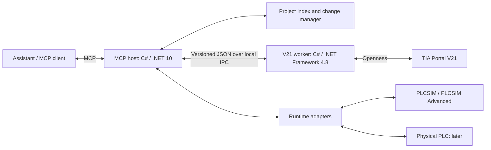

# TIA MCP implementation plan

**Release scope update — 15 October 2026:** The user requires every feasible capability before 1.0. Read the [current release ledger](release-obligations-20261015.md) before scheduling work. Older wording that permits optional expansions, selected-only release scope or a reduced 1.0 is superseded. Missing prerequisites and unresolved feasibility remain release blockers; recorded passed/failed evidence and native/UI scheduling boundaries remain intact.

Originally written 8 October 2026. See [current status](../STATUS.md) and the
[remaining TODO](../TODO.md) for the latest checkpoint and work order.

**Continuation — 9 October 2026**

The user resumed the remaining engineering work and extensions. Existing VM offline-engineering, SSH and recovery proof is accepted as sufficient for this continuation. VM requalification is not a delivery gate and is not being scheduled; historical exact-build evidence remains unchanged.

Continuation order: runtime lifecycle and measured timer assertions; one frozen local build and regression run; remaining LAD/FBD, library and eligible HMI acceptance; project snapshot comparison and impact reports; reusable PLC component installation; project health reporting; persistent source search; configured distributed I/O/network coverage. Track implementation separately from actual native evidence, and preserve prior reports. This workspace has no Git metadata; a source-before manifest is retained under `artifacts/continuation-20261009/` before implementation.

Implemented in this continuation: five new public tools (durable simulator creation inspection plus persistent project capture/compare/search/health), clean native worker-exit observation, uncertainty admission fix, measured timer assertions, independent native artifact roots and configured subnet/I/O association inspection. The catalog now contains 79 tools, 52 prepared mutation kinds and 149 features. Native review/offline-restart and exact simulator handoff fixtures passed. Both revised timer cases pass all 18 assertions with verified cleanup. The HMI profile defect is corrected; basic inspection passed on five installed profiles and richer relationship checks passed on both Unified profiles, while overall HMI mutation acceptance remains open. Archive recovery path validation and worker-scoped runtime-manager cleanup are included in frozen build `cb6299c72baf44d4b05278d878a536a0`; its full regression and strict relocated package checks passed. All 28 remaining standard LAD/FBD engineering cells passed their four native gates, with 489 independent XML comparisons and 84 exact owned TIA exits. Full runtime attempt 06 ended after 48 passing cases/371 assertions and one pre-start isolation failure; 16 cases were unattempted. The user-requested clean resource checkpoint and resume notes are saved; no next feature implementation started. The full TODO and corpus remain incomplete. The build also adds a bounded read-only wait for two consecutive empty pre-start discovery snapshots; exceptions, persistent entries and expired waits cannot authorize startup. See the [current delivery/evidence record](../history/continuation-20261009.md), [persistent reviews](../guides/project-reviews.md), [network inspection](../guides/network-inspection.md) and [runtime continuation](../history/runtime-proof-todo.md).

The [full library management implementation plan](library-management-plan.md) specifies ZIP intake, project/global libraries, native type versions and master copies, PLC and HMI integration, authoring/publication, recovery, and release acceptance. See [library management](../guides/library-management.md) for the implemented tools, supported native subsets and remaining qualification gates; the full acceptance scope is not yet completely qualified.

The [graphical engineering and project explorer roadmap](graphical-project-roadmap.md) splits the related new work into three implementation plans: typed LAD/FBD builders, a shared project explorer for humans and agents, and HMI integration. It defines their ownership, shared contracts, delivery order, and acceptance gates alongside the library workstream.

Build an MCP server that lets an assistant inspect, debug, create, and maintain TIA Portal projects. The first target is TIA Portal V21 on this Windows PC, with offline projects and PLCSIM first. Support KOP/LAD, FUP/FBD, SCL, and AWL/STL wherever the selected CPU supports them. Design the connection boundary now so TIA can run in a Windows VM or another engineering PC later.

The implementation now spans inspection, static analysis, recoverable language edits, a PLCSIM Advanced V8 runtime adapter, hardware/TO/safety subsets and local/SSH packaging. See the [verification matrix](../history/verification.md) for actual passing fixtures and outstanding runtime/deployment limits, and the repository README for current tool names and commands. Broad engineering coverage remains the product goal; individual operations become supported only after verification against the installed API, project, CPU, firmware, and licenses. The broader milestones below describe the target, not a claim that every feature is complete.

The workspace was empty at the start. V21 Openness assemblies, XML API documentation, schemas, the .NET Framework 4.8 reference assemblies, and .NET 10 SDKs are available locally. TIA V15.1/V17/V19 installation folders also exist, but those versions are outside the first release. The runtime adapter uses the installed PLCSIM Advanced V8 API; standard PLCSIM V21 is detected but has no implemented runtime adapter. See [simulation compatibility](../guides/simulation.md) for CPU, firmware and licensing evidence.

The first useful outcome should be: “Explain this FB, show its callers and the signals it writes, trace a signal back to configured I/O, create or change a block, compile it, and exercise it in a simulated PLC.”

**General-purpose product requirement — clarified 8 October 2026**

The product must be reusable across users and projects. Customer-specific requests are optional feedback, not a prerequisite for developing broader coverage. TIA V21 remains the initial version boundary; universal usefulness is pursued through a documented capability contract and systematic qualification, not an assertion that every TIA function works on every CPU.

Derive the backlog from the installed Siemens API, official engineering documentation and the complete object/operation model. For every operation, record three separate facts: vendor API availability, implementation in this bridge, and observed qualification on a particular environment/target. Classify unsupported, unavailable, protected and untested cases explicitly. A single successful CPU or language fixture must not promote a whole feature family to verified support.

The general-purpose development stage uses parallel workstreams with shared versioned feature IDs, object identities, capability reports, fixture manifests and test results. Specification and acceptance criteria guide independent object-model, discovery and fixture implementation; final integration qualification follows their combination.

The historical v0.3 increment provided 43 public tools and a 79-feature catalog and the first fourteen generated engineering scenarios. The live corpus completed 73 successful steps on CPU 1511-1 PN V4.0, while its runtime vectors remain unexecuted. The three new public entry points are `feature_catalog`, `object_resolve` and `target_capabilities`. See [generalization verification](../history/generalization-verification.md), [contracts](../../contracts/README.md), [object scope rules](../reference/object-model.md), [capabilities](../reference/capabilities.md), and [conformance fixtures](../guides/conformance-fixtures.md).

The deliverables and continuing acceptance criteria are:

| Deliverable | General-purpose requirement | Acceptance evidence |
|---|---|---|
| Feature and compatibility catalog | Map sessions, project scopes, blocks, languages, types/tags, hardware, networks, TOs, libraries, safety and runtime to supported operations and vendor prerequisites. Distinguish TIA version/update, CPU family/firmware, installed options and deployment. | Every public MCP operation has an explicit support contract and linked implementation/test evidence; missing areas remain visible backlog items. |
| Target-scoped capability discovery | Inspect available services and typed attribute/parameter metadata on the selected project and object. Report read/write access, enums, ranges/units where actually exposed, and missing metadata. | Capability answers vary correctly with the target and installation; a static global “conditional” list is insufficient. Readable metadata alone never grants unrestricted mutation. |
| Common identities and scope resolution | Share traversal/selection between reads, writes, references and conflict detection. Include root groups, nested groups, namespaces, software units and safety units where the native API permits the operation. | Duplicate names in different scopes resolve through exact identities; edits cannot silently select a root block while inspection showed a unit block; revisions cover every supported mutation target. |
| Language and engineering adapters | Expand structured LAD/FBD network editing by instruction family, preserve untouched native data, and add typed hardware/TO/library adapters from documented capabilities. Keep dedicated safety semantics and validation. | Each supported operation preserves unrelated metadata, survives export/import/reopen, compiles, and has behavioral or configuration assertions appropriate to that feature. Unknown native structures remain intact and explicitly opaque. |
| Generated conformance projects | Generate isolated reference projects covering applicable CPU families/firmware, all requested languages, FB/FC/OB/DB/UDT/tag structures, instructions, instances, I/O, TO families, scope/naming variations and project sizes. Expected behavior comes from fixture specifications, not from the implementation under test. | Repeatable tests run without a customer project. Use representative and pairwise combinations plus exhaustive checks for critical boundaries; publish the exact tested combinations instead of claiming exhaustive device coverage. |
| Product deployment and reliability | Remove dependence on this workstation's paths, usernames, credentials and fixture names. Add actionable setup diagnostics, large-project paging, cancellation/reconnection and local/VM qualification. | Clean-machine and VM tests under ordinary authorized users; missing installation/license/service reports are distinct from empty data or successful execution. |

The first conformance library should cover boolean logic, comparisons, arithmetic, conversions, timers, counters, edge detection, latches, branching, calls and parameter binding, single/multi-instances, arrays, strings, nested UDTs, optimized/non-optimized DBs, OB variants, namespaces, duplicate names, multilingual comments and protected content. Hardware/TO fixtures should cover catalog-driven modules and addresses, network changes, PID, counting and motion families with CPU/version-specific prerequisites. Test supported standard and safety operations separately. Physical commissioning and safety acceptance are not established by compilation or simulation.

Every write feature needs no-change roundtrip checks, precise change-diff checks, native compilation and save/reopen verification. Add behavior tests when executable, and failure tests for stale previews, partial native failures, interrupted workers, unavailable services and recovery. For example, changing one LAD contact must leave unrelated networks, symbols, comments and attributes unchanged; the expected output must also pass a known stimulus sequence when simulation is available. Normalization may remove export provenance timestamps, never unexplained program content.

The v0.3 object model adds shared scope-aware selection and typed unit mutation routes; target discovery replaces reliance on a static global list for current-object answers. Native unit qualification must be assessed through its dedicated evidence, not inferred from root-scope fixtures. Remaining gaps include broad graphical instruction editing, fixed hardware attribute subsets, additional TO combinations, normalized array-element start values, native multilingual/protected-object coverage, large-project qualification and repeatable save/reopen/behavior checks across representative configurations. The catalog makes these gaps explicit. The historical PLCSIM startup problem was followed by a passing protected runtime baseline. Remaining corpus work is tracked in runtime-proof-todo.md. Existing VM proof is accepted for this continuation; no VM rerun is required.

Primary scope references: [Siemens V21 technology-object functions and families](https://docs.tia.siemens.cloud/r/en-us/v21/technology-objects), [Siemens' TIA Portal AI Extensions development reference collection](https://github.com/siemens/tia-portal-ai-extensions), and the installed V21 API XML documentation. These are feature-discovery inputs; public documentation or examples alone are not qualification evidence for this bridge.

1. **Use separate engineering and runtime connections.**

   Openness is the main interface for TIA projects. Live values and simulation control belong behind a separate runtime interface. Creating a watch table is an engineering operation; collecting its live values is a different capability. Do not assume that a feature visible in a TIA editor has an equivalent public API.



   Use the official C# MCP SDK for the host, starting with stdio. Use a separate x64 .NET Framework 4.8 worker for Siemens assemblies. V21 requires .NET Framework 4.8 and introduced modular assemblies incompatible with older applications without rebuilding. Load the installed assemblies, with `Copy Local=false`, and isolate Siemens types inside the worker. This process boundary also contains worker failures. [Siemens V21 migration documentation](https://docs.tia.siemens.cloud/r/en-us/v21/readme-tia-portal-openness/major-changes-for-long-term-stability-in-tia-portal-openness-v21), [official MCP C# SDK](https://github.com/modelcontextprotocol/csharp-sdk).

   Start the worker in the logged-in engineering user's Windows session. Use a current-user-restricted named pipe and a versioned JSON contract containing plain data, never serialized Siemens objects. Queue engineering operations per session; allow parallel processing of exported data outside the worker. Maintain explicit host, session, project, and PLC identities. Disconnecting the MCP must not close an existing user-owned TIA instance.

   For VM use, install the host and worker inside the guest beside TIA. Expose the same MCP tools through authenticated HTTPS/Streamable HTTP or an authenticated tunnel. Resolve all project paths on the TIA host and transfer artifacts explicitly. Add this deployment after local behavior is proven; do not attempt to use the host's Openness DLLs to attach across machines. Network access from the guest to a simulated or physical PLC is a separate configuration concern.

2. **Build a capability registry and a useful project model.**

   `tia_capabilities` reports each operation as supported, conditional, unsupported, or unverified, with its reason and prerequisites. Distinguish missing licenses, unavailable services, protected content, read-only projects, unsupported CPUs, and disconnected sessions. Presence of a method in XML documentation is evidence for a prototype, not proof that it works on every object.

   Represent devices, software units, groups, blocks, interfaces, networks, symbols, UDTs, DBs, tags, hardware modules, channels, addresses, technology objects, and library relationships. Preserve project languages, comments, block numbers, instance relationships, optimized access settings, and relevant attributes. Keep original exports alongside a normalized model; unsupported structures remain intact and explicitly opaque.

   Each result carries its origin, object identity/path, project revision or fingerprint, timestamp, and completeness. Distinguish offline configuration, DB start values, saved snapshots, simulated values, and physical PLC values. Include quality and instance identity with every runtime sample.

   Use SQLite for the searchable index, with ordinary tables for graph edges and full-text search for source/comments. Index incrementally using available fingerprints and targeted re-reads. Expose paginated queries and bounded graph traversal. If TIA cannot provide a reliable change notification, revalidate affected objects before answering critical queries or applying changes; never silently serve an obsolete graph as current.

3. **Deliver project understanding before broad mutation.**

| Area | Planned behavior | Implementation boundary |
|---|---|---|
| Sessions and projects | Discover V21 instances, attach, open/create projects, inventory, save/archive | Explicit ownership of launched instances and opened projects |
| Blocks | Read FB/FC/OB/DB interfaces, implementation, attributes, comments, instances | Preserve language and distinguish inaccessible protected content |
| Cross-references | Uses/used-by, read/write/call access, source location, member references | Native CrossReferenceService first; retain textual member references |
| Call structures | Caller/callee trees, OB roots, instance paths, dependencies, impact analysis | Static graph with unresolved indirect calls clearly marked |
| Hardware and I/O | Devices, racks, slots, modules, channels, I/Q addresses, HW IDs, networks | Catalog/module-specific coverage; mark inferred channel mappings |
| Technology objects | List type/version, parameters, linked drive/encoder/I/O, related calls | Capability checks by TO type/version and CPU |
| Diagnostics | Compiler messages, inconsistent references, multiple writers, potential unused blocks | Findings include evidence and coverage limits |
| Runtime debugging | Values, trends, simulation stimulus, supported state/diagnostic access | Separate adapters; do not promise full TIA monitor-editor parity |

   Siemens exposes native cross-reference results, including access and location information. Some member references provide text but no underlying engineering object. The index must handle that explicitly. [Siemens V21 cross-reference API](https://docs.tia.siemens.cloud/r/en-us/v21/tia-portal-openness-api-for-automation-of-engineering-workflows/tia-portal-openness-api/functions-for-accessing-the-data-of-a-plc-device/functions-for-accessing-plc-service/getting-cross-references-for-step7).

   Derive call edges from native call references and verified block exports. Preserve individual call sites, single/multi-instance paths, and parameter bindings. Include startup, cyclic, interrupt, and other OB roots. Treat library internals, protected blocks, indirect addressing, pointers, and dynamic calls as possible gaps. “Potentially unused” is not authorization to delete.

   For “What writes this output?”, combine symbolic references with absolute address ranges so overlapping bit/byte/word accesses are considered. Connect configured module addresses to tags and call sites. Extend this later to parameter propagation through FB instances and supported network/data-flow analysis. A hardware address mapping describes project configuration; electrical terminal assignments require additional evidence.

4. **Make each language a first-class editing format.**

| Language | Read representation | Creation and editing route |
|---|---|---|
| SCL | Source, declarations, comments, locations | Generate/import external source or supported XML; compile and re-export |
| AWL/STL | Native instruction text, declarations, labels | Source or XML route verified for the selected CPU; preserve dialect |
| KOP/LAD | Networks, contacts, coils, boxes, pins, wires, branches | Structured network edits serialized to validated SimaticML |
| FUP/FBD | Networks, operations, pins, connections, execution structure | Structured network edits serialized to validated SimaticML |
| F-KOP/F-FUP | Safety language identity, permitted instructions and connections | Safety-aware variant of the graphical pipeline, verified separately |

   Source generation is documented for SCL/STL, DBs, and UDTs; it has state and encoding requirements, including offline PLC state and UTF-8 BOM for relevant source writes. Handle those requirements as tool preconditions. [Siemens source generation](https://docs.tia.siemens.cloud/r/en-us/v21/tia-portal-openness-api-for-automation-of-engineering-workflows/tia-portal-openness-api/functions-for-accessing-the-data-of-a-plc-device/blocks/generate-source-from-block).

   For graphical languages, maintain an intermediate network representation with stable internal IDs, typed pins, instruction versions, operand references, and preserved unknown XML fragments. Never use regex replacements to rewire a network. Validate schema, connections, identifiers, and instruction compatibility, then ask TIA to import and compile. Scope early editing to a documented subset, expanding through real exported fixtures.

   Support create, update, duplicate, rename, move, and delete for eligible blocks, plus UDT/tag/DB operations. Block creation includes interface declaration, number allocation, required types, optional instance DB, and an optional call site. Interface changes require impact analysis on callers and instance DBs. Preserve existing languages unless a conversion is explicitly requested and supported.

   A native language export and TIA compile provide structural validation. Behavioral validation requires simulation tests; a successful compile does not establish functional equivalence.

5. **Apply changes through a recoverable change set.**

   Use the sequence: inspect → prepare changes → show semantic diff and affected objects → validate → apply → compile → re-read → record outcome. A previously authorized offline edit can execute this sequence without asking for approval for every individual API call.

   Every change set binds to a specific project, PLC, base fingerprint, and artifact hash. Check for intervening user edits before applying it. Capture original exports and use a TIA-supported project archive/checkpoint where appropriate, including explicit handling of unsaved project state. Validate major transformations in a scratch project or supported copy when practical.

   Use short exclusive-access windows and Openness transactions where the particular operations support them. Do not assume imports, saves, compile, or download form one atomic transaction. Record completed steps and partial failures. If restoration cannot be guaranteed, report the actual project state and recovery artifact; never claim rollback without checking it.

   Writes require idempotency keys and an operation journal. A timeout or disconnected client must not automatically repeat a mutation. If an API call cannot be cancelled, report that it is still running and reconcile before allowing another write. Revalidate and invalidate caches after imports, deletes, renames, compile, and reconnect.

   Keep project edits, simulated runtime writes, and physical PLC actions distinct in tool contracts. Later downloads, physical writes/forces, CPU state changes, and safety commissioning need explicit target and operation authorization. Those controls are outside the model's discretion and cannot be bypassed through a generic attribute setter. This plan does not authorize connecting to or changing a physical PLC.

6. **Add hardware, TO, and safety engineering as tested modules.**

   Hardware editing should cover catalog lookup, station/module creation, slot changes, deletion, channel parameters, I/O addresses, PROFINET names/IPs, subnet and IO-system assignments, and supported topology. Read current attribute metadata and the installed hardware parameter descriptions before writing. Check module compatibility, address overlap, catalog/HSP/GSD dependencies, and compile results. Start with a small representative hardware set, then broaden coverage.

   Technology-object tools should enumerate available type/version combinations, create/delete objects, edit parameters, and resolve drive/encoder/hardware connections. Begin with representative motion and PID objects. Motion commands, tuning actions, and live TO state belong to runtime adapters. Siemens documents separate TO create/delete/parameter operations and V21 assembly changes. [Siemens technology objects](https://docs.tia.siemens.cloud/r/en-us/v21/technology-objects/upgrading-to-openness-v21?contentId=bDQSpJdDLSEbtKQy7SQYRg).

   Safety support includes eligible F-blocks, safety units, F-runtime groups, exposed administration settings, F-I/O configuration, signatures, compilation, and supported reports. Build read support early and enable offline writes after dedicated fixtures pass. Preserve F-language markers, protection state, and supported workflows. Siemens permits consistent F-block import/export but excludes F-system-block export. [Siemens V21 F-block export](https://docs.tia.siemens.cloud/r/en-us/v21/tia-portal-openness-api-for-automation-of-engineering-workflows/export/import/importing/exporting-data-of-a-plc-device/blocks/exporting-failsafe-blocks?contentId=4fkV6Bg4z8KfNXWM0K9X3Q).

   Record signature changes and distinguish “compiled,” “tested in simulation,” and “accepted safety application.” The MCP can prepare engineering changes and evidence; the actual machine's safety validation/acceptance remains a separate engineering workflow. Do not provide a generic route that converts F-blocks to standard blocks or bypasses protection.

   Extend coverage later through dedicated modules for libraries/master copies/type versions, Startdrive, HMI/WinCC, traces, test suites, and other installed options. Public object introspection can expose supported metadata broadly, while mutations retain typed validation. “Anything” should become a growing, visible capability matrix rather than an unrestricted code-execution tool.

7. **Make PLCSIM debugging an early deliverable.**

   Run a feasibility spike for the installed PLCSIM edition, Advanced API, licenses, CPU family, firmware, and TIA compatibility before choosing the automation path. Start with a supported S7-1500 test target if no project is supplied; choose the exact order number/firmware from the installed catalog. Add an F-CPU fixture once the required Safety and simulation capabilities are established.

   Prefer a documented PLCSIM Advanced API where available. Prove instance discovery, download path, run/stop, symbol/value access, input stimulus, and bounded capture. Standard PLCSIM remains a candidate, but do not assume it offers the same external automation surface. The first feasibility report must explicitly state which parts can be automated with the installed edition.

   A simulated test scenario sets initial conditions, applies timed inputs, observes outputs/state, evaluates assertions, and saves a result artifact. Model simulation time and synchronization explicitly; host polling alone must not be presented as scan-accurate evidence. Siemens' Advanced I/O API has synchronization semantics that must be validated. [Siemens PLCSIM Advanced I/O synchronization](https://docs.tia.siemens.cloud/r/simatic_s7_1500_et_200mp_manual_collection_enus_21/comprehensive-information/cpu-function-manuals/s7-plcsim-advanced-api/iinstance/i/o-access/synchronizing-inputs-and-outputs?contentId=kQN_RFyPEWIdMKG0J1I6Kg).

   Later physical adapters can use OPC UA or the Siemens CPU Web API when enabled and supported. Select protocols by the real CPU's capabilities and permitted symbol access. The CPU Web API documents value reads and discovery of available methods; supported methods and user permissions must both be checked. [Siemens CPU value reads](https://docs.tia.siemens.cloud/r/simatic_s7_1500_et_200mp_manual_collection_enus_21/comprehensive-information/cpu-function-manuals/web-server/api-application-programming-interface/reading-and-writing-process-data/plcprogram.read?contentId=6rEaX6Ix8XQ2wNdmf08eVg), [Siemens API discovery](https://docs.tia.siemens.cloud/r/simatic_s7_1500_et_200mp_manual_collection_enus_21/comprehensive-information/cpu-function-manuals/web-server/api-application-programming-interface/web-api-basic-functions/api.browse?contentId=krnSRpSbbQ0S7gCzxGGFOA).

   Do not promise arbitrary TEMP/local-variable visibility, instruction stepping, full live ladder power-flow, or every trace/diagnostic feature until a supported interface is demonstrated. Report missing runtime evidence directly. Keep credentials in the Windows credential store or protected local configuration, out of tool results and source control.

8. **Expose task-sized MCP tools.**

   These are proposed names, not existing APIs. Tools should return compact structured data; large exports, logs, graphs, and captures become addressable artifacts/resources. Use progress reporting and application-level job IDs for long operations without depending on optional MCP protocol features.

| Tool family | Examples |
|---|---|
| Connection | `tia_discover`, `tia_attach`, `tia_session_status`, `tia_capabilities`, `tia_detach` |
| Projects | `project_open`, `project_create`, `project_inventory`, `project_save`, `project_checkpoint` |
| Inspection | `object_describe`, `block_read`, `symbol_search`, `xref_query`, `call_graph`, `io_map`, `change_impact` |
| Editing | `block_prepare_create`, `block_prepare_update`, `block_prepare_delete`, `tags_prepare_change`, `types_prepare_change` |
| Hardware/TO/Safety | `hardware_read`, `hardware_prepare_change`, `to_read`, `to_prepare_change`, `safety_inspect`, `safety_prepare_change` |
| Changes and jobs | `change_preview`, `change_validate`, `change_apply`, `change_restore`, `compile`, `job_status` |
| Simulation/runtime | `runtime_connect`, `runtime_read`, `runtime_capture`, `simulation_prepare`, `simulation_run_test` |

   Each mutating call routes through the same change service or explicit runtime action policy. Provide precise errors, such as `UnsupportedCapability`, `ProtectedObject`, `StaleRevision`, `ProjectBusy`, `CompileFailed`, and `RecoveryRequired`, with actionable details. Treat comments, source text, and imported metadata as project data, never as instructions to the assistant.

9. **Deliver in milestones with observable exit criteria.**

| Milestone | Deliverable | Exit criterion |
|---|---|---|
| M0: feasibility | V21 worker prototype, capability report, simulator probe | Attach to V21; inventory one scratch PLC; export sample languages; query native references; document working simulation route and gaps |
| M1: inspection MVP | MCP host, block/source reads, search, xrefs, call graph, I/O/TO/safety inventory | Answer “who calls this FB?” and “what writes this signal?” with verified locations from a mixed-language fixture |
| M2: standard editing | Change sets; FB/FC/OB/DB/UDT/tag CRUD; SCL/AWL editing | Create/change/restore blocks, preserve metadata, compile, reject stale edits, and recover from a deliberately failed import |
| M3: simulation debugging | Runtime adapter, capture, input scenarios, assertions | Run a repeatable block test in PLCSIM and associate results with the exact compiled revision |
| M4: graphical editing | Structured KOP/FUP reader and editor for an expanding instruction subset | Round-trip representative networks without unrelated changes; compile and behavior-test supported edits |
| M5: engineering breadth | Hardware/network/TO CRUD and dedicated safety editing | Modify representative configurations and F-block fixtures; compile; report signature and dependency changes; demonstrate recovery |
| M6: deployment and expansion | VM connection, packaging, diagnostics, physical adapters, additional engineering modules | Repeat supported workflows with TIA inside a VM; authenticate remote access; qualify each physical capability on an authorized bench |

   M0 includes simulation feasibility so a licensing/API blocker is discovered early. M1 includes reading all four requested standard languages. M2 and M3 establish an end-to-end useful workflow before arbitrary KOP/FUP editing is complete. Safety writes and hardware breadth are explicit deliverables, not implied coverage of the initial MVP.

10. **Validate behavior against TIA and keep the codebase modular.**

   Proposed structure:

```text
src/
  TiaMcp.Host/                 MCP tools, resources, transport
  TiaMcp.Contracts/            Versioned plain-data IPC contracts
  TiaMcp.Core/                 Capabilities, identities, changes, jobs
  TiaMcp.Index/                Search, relationships, invalidation
  TiaMcp.Openness.V21/         .NET Framework 4.8 worker
  TiaMcp.SimaticML/            Lossless exports and network model
  TiaMcp.Runtime/              Runtime adapter contracts
  TiaMcp.Runtime.Plcsim/       Verified simulation integration
tests/
  Unit/                       Parsers, graph queries, conflict handling
  Integration/                Real TIA and simulator tests
  Fixtures/                   Small mixed-language reference projects
docs/
  README.md                   Documentation index
  STATUS.md                   Current checkpoint
  TODO.md                     Remaining work order
  guides/                     Usage and operations
  reference/                  Contracts and supported scope
  plans/                      Implementation and acceptance plans
  verification/               Recorded tests and qualification
  history/                    Dated checkpoints and handoffs
```

   Build contract/parser/index tests without TIA; run engineering integration tests on a Windows machine with V21. Compare native references and inventory to manually established expectations in fixture projects. Cover multilingual comments, arrays/UDTs, optimized DBs, single/multi-instances, absolute-address overlap, unsupported/protected objects, and safety blocks.

   Exercise failed compilation, partial mutation, user edits after preview, TIA closure, worker failure, and lost client connections. Verify create/update/delete persistence after save/reopen. For graphical changes, compare normalized pre/post exports and run behavior tests for branches, edge detection, timers, latches, and call parameter wiring. Freeze fixture expectations per TIA update and simulator version.

   The initial M0 host/worker task has been completed. Continue using the verification matrix to select further representative CPU/program fixtures; API presence alone does not establish device support. Broader graphical instruction editing, changed safety logic, additional TO families and execution inside a VM remain separate qualification work.

