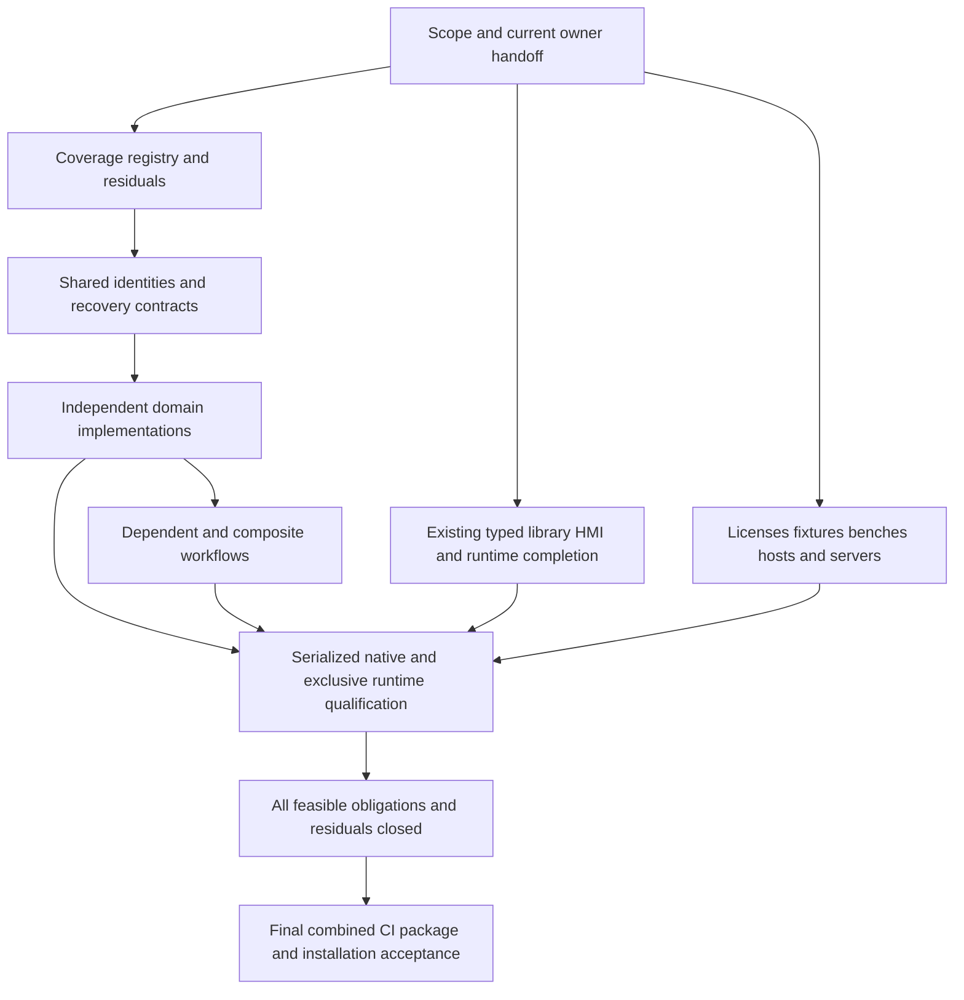

# TIA MCP release obligations and execution order

**Subsequent execution update:** This document and its JSON retain the pre-wave release audit. The user has since confirmed the old coordinator stopped; this session owns integration. Prompts 02/01/03/06 and the first AC-01 implementation slice are now delivered. Use [current handoffs](../history/active-handoffs-20261015.md) and [wave results](../verification/ac01-planning-wave-20261015.md) for those newer states.

**27 October 2026 update:** Host-only runs now verify 65 offline features: VCI (D01), translation review (D03), OPC UA NodeSet (D04), AutomationML (D05), GRAPH (X06), the offline diagnostic/trace/experiment/UA-diagnostic tools (D17) and the upload tools. Their native parts remain open. Each affected obligation has an `executionNotes` entry in the JSON. The [sweep record](../verification/host-only-qualification-20261027.md) also ranks the remaining offline-reachable work.

**27 October 2026 status refresh:** Each obligation's `implementation`, `qualification` and `currentResult` in the JSON, its plan status, and the current-state columns below now reflect current code, catalog 0.4.30, the [release matrix](release-matrix.v1.json) and retained verification records; the JSON's `statusRefresh` records the sources. Remaining work, next actions, dependencies, blockers, counts and the historical sections keep the 15 October audit, and the earlier status values are in Git history. Release acceptance is unchanged: no obligation or feature is accepted.

**28 October 2026 status refresh:** Against catalog 0.4.68, each obligation's `currentResult` in the JSON now starts with its release-matrix counts, and the 30 obligations changed since 27 October add a dated note with rewritten `implementation`/`qualification` labels. `remainingWork` and `nextAction` were rewritten for 34 obligations from the open matrix rows, recorded blockers and the [TODO](../TODO.md); F01, F02, L06, D15, X05, X09, X12, X13, C01 and C04 keep their 15 October text. The `current` text of eight blockers (B01–B05, B07–B09) and the blocker table below were refreshed too. The workstream table under [Current results](#current-results) still shows 27 October; [open matrix rows by owner](../TODO.md#open-matrix-rows-by-owner) lists what is open now, and the 27 October values are in commit `53d4be7`. Release acceptance is unchanged.

Audit date: **15 October 2026, Europe/Berlin**. **1.0 is not ready. Every feasible capability is a release obligation.** This includes the existing plans, all 18 expansion prompts, the additional API roadmap families, and feasible capabilities discovered while closing the API inventory. Missing products, licenses, fixtures, hardware, supported hosts or qualification are blockers, not reasons to remove an obligation. Unresolved feasibility stays open; an impossible route needs an evidence-backed disposition and consideration of supported alternatives.

This scope decision supersedes older wording about optional expansions, selected release packages, reduced PLC-only releases and deferring feasible work beyond 1.0. Delivery can proceed in useful increments, but those increments do not authorize a 1.0 release. Implementing safety tooling is distinct from certifying an application's functional safety. Release scope also does not authorize arbitrary physical operations, external publishing, installations or resuming the recorded native UI pause.

Use the [machine-readable ledger](release-obligations-20261015.json) for all **44 workstreams, 160 catalog feature records, 165 historical checklist items, 18 prompts and 11 blocker groups**. It retains implementation and qualification separately, exact source/evidence references, dependencies, next actions and proposed owner roles. The immutable audit snapshot (`artifacts/release-audit-20261015/current-results.json`) records the inspected files and hashes. Historical line references in that snapshot refer to the pre-edit document bytes.

## Current results

On 28 October the source contains **310 registered MCP tools, 117 prepared mutation kinds and 450 catalog features** (catalog 0.4.68); 359 features are verified and 91 unverified. The release matrix binds 1,639 cells to evidence; 398 are open and 30 deferred ([current status](../STATUS.md)).

On 27 October the source contained **265 registered MCP tools, 57 prepared mutation kinds and 340 catalog features** (catalog 0.4.30). The catalog labels 134 implemented, 196 partial and 10 not implemented; its qualification labels are 121 verified and 219 unverified. The release matrix binds 441 of its 1,578 cells to evidence; 1,107 are open and 30 deferred. These are catalog classifications, **not a release completion percentage**. A verified fixture does not close an entire feature family or qualify a later combined binary, and Host-only verification does not qualify a native route.

On 15 October the source had 87 tools, 55 mutation kinds and 160 features. That audit captured 1,031 source, contract, fixture, test, UI, build and documentation files. All 632 files in the previous roadmap source inventory still matched before these documentation edits. All referenced catalog evidence paths exist. Its `python -B scripts/test_contracts.py` check passed for all of them; on 27 October the same check passes for 265 tools, 57 mutation kinds and 340 features. No native run, build, simulator initialization, PLC connection or deployment was performed by this audit.

| Workstream | Retain as completed evidence | What still blocks completion |
| --- | --- | --- |
| **L01 Typed LAD/FBD** | All 38 standard cells and 28 standard created-storage cells pass PLCSIM runtime; all 140 software-unit/namespace route cells pass engineering and runtime; insertion variants pass engineering (24–26 October). | Candidate lineage, transitive unit/namespace parents, custom shapes and native `network_insert`/`call_connection_set`. Original c03 cleanup stays failed. |
| **L02 PLC components** | A fresh FB/UDT component installation with FC/DB/call/bindings passed compile, preservation, reopen, first-checkpoint recovery and PLCSIM runtime (24 October); installation into an existing FBD FC caller passed (25 October). Component07 stays failed; the later fresh installation supersedes it for that scope. | Production `library_integrate` apply stays disabled. LAD/FB/OB callers, existing-caller runtime and the native05 recovery audit remain open. |
| **L03 Simulator/runtime** | The frozen 65-case, 358-step, 478-assertion corpus passed with an independent audit; requested stop, card inventory and lock release passed on this PC (24 October). | Credential-provisioning preservation, `project_simulation_enable`, the unexplained card-staging access denial and the VM-only zero-address, dispatch-ticket and `.info` items. |
| **X02 Libraries** | Native V21 releases with PLCSIM behavior, dependencies, lifecycle, formats, V14–V18 upgrades, two PLCs, software units, protected FBs, unit relations and kill-point multi-resource recovery (24–27 October). | HMI library lifecycles, combined integrate, namespaces, V20/PAL import and native scale. |
| **X07/X08 HMI** | Bridge retrieval, read-only inspection, Explorer and save/reopen/recovery passed for Classic Comfort, RT Advanced, Basic, Unified Comfort and Unified PC (25 October); Unified `external_tag_create` prepare passed (26 October). | Classic compile needs a start screen and its PLC declaration mapping fails; RT Professional is refused; Unified bridge compile, apply and preserving writes, content families beyond gated BackColor, and visual/runtime acceptance. |
| **X10 Hardware/remote I/O** | The CPU 1511/IM 155-6/AI route passed all ten gates including the Smoothing channel write, so `channelWriteQualified` and `fullRemoteIoRouteQualified` hold for that profile (24 October); CPU memory bytes pass on every S7-1500 CPU (26 October). | Replacement, GSD/HSP, topology and ports, shared devices, redundancy and the other hardware families. |
| **L04 Explorer/reviews** | Native providers for configured networks, technology connections and software-unit relations plus their collections (26–27 October), relationship scope and reviews (24 October); VS Code renders retained snapshots. | Native desktop round trip, broader topologies and relations, alarm text lists and libraries. |
| **D04 OPC UA** | The offline module is integrated as eight Host `opcua_*` NodeSet tools, verified Host-only (27 October). | No worker OPC UA adapter; the UA-03 eligibility/export packet is prepared but not run. Native discovery, mappings, category mutations, security and recovery remain open. |
| **D17 Diagnostics/trace** | 18 diagnostic, trace, experiment and UA-diagnostic features are verified Host-only (27 October, 54 cells bound). | Two runtime-acquisition features, the native instance oracle, trace configuration and lifecycle, actual fault capture and the AX route (B06). |
| **L05/L06 Compatibility and release** | Native DMC V14 SP1–V19 library upgrades, vendor intake and locked-source refusal passed; the vendor intake review is complete. Hosted CI (contracts with the matrix check, managed shards, OPC UA, portable package, Explorer) passed on `main` on 27 October. | Native scale, a V20 library, PAL native import, VM requalification, the immutable engineering bundle, an installation/rollback receipt and combined native release acceptance. |

Per-obligation evidence is in the JSON's `evidenceAndSourceRefs`. 15 October audit evidence: typed handoff (`artifacts/p17t/workstream-handoff-02.json`), component07 terminal result (`artifacts/p17n/component-native-07/result.json`), runtime audit (`artifacts/continuation-20261009/runtime06-final-audit.json`), HMI audit (`artifacts/p17h/copy-inspection01-audit.json`), native07 audit (`artifacts/p17n/native07-independent-audit.json`), [OPC UA evidence](../verification/opc-ua-offline-20261014.md), [trace completion audit](../verification/trace-diagnostics-completion-audit-20261014.md), combined validation (`artifacts/p17r/combined-validation-02.json`), later offline regression (`artifacts/trace-diagnostics-full-20261014/regression/result.json`).

### Corrections to stale work orders (15 October)

- Do not dispatch the old 19-input typed capture again: capture and separate copied persistence are recorded. The failed original cleanup is not converted into a pass.
- Do not redispatch native07's limited remote-I/O lifecycle as unfinished. The next missing scope is writable-channel qualification and broader profiles.
- Component07 is **failed**, not still being qualified. A historical admission receipt does not identify a current owner or authorize another run.
- The old OPC UA report's missing diagnostic catalog registrations are historical. All eight diagnostic tools are now registered and the current contract check passes.
- The OPC UA frozen source manifest matches 60 of 71 current inputs. Eleven shared diagnostic/contract/catalog/document inputs changed; UA-owned implementation files still match. Retain its exact historical pass and validate the combined integration before claiming current-build acceptance.
- The latest diagnostic receipt matches 21 of 22 source hashes; the mismatch is the later AX feasibility document, not diagnostic implementation. Its updated package-unavailability finding must be retained.
- Typed reference captures, ordinary standard engineering, advanced-unit engineering, library lifecycle, timer timing correction and durable simulator-creation work are not all new tasks merely because an older checkbox remains unchecked.
- Existing VM evidence stays accepted. Missing feature-specific remote behavior is a separate obligation; it does not require repeating accepted general VM tests.

The audit rechecked all 15 referenced hashes in the typed handoff and all 15 in the combined validation receipt. It did not rerun those native tests or independently re-audit every raw measurement in every historical receipt.

## Foundations and execution hierarchy

The AC numbers refer to work packages in the [API roadmap](expansion-plans/api-coverage-and-roadmap.md), not the numbered prompt files. F/L/D/X/C identifiers belong to this ledger; D01-D17 and X01-X13 preserve the roadmap family IDs.

| Order | Package | Concrete exit | Parallel work allowed |
| --- | --- | --- | --- |
| **0** | **F00 / AC-00** | This scope decision and current results are recorded. Obtain present owner/file/resource handoffs; keep unknown ownership explicit. | Every read-only domain planning task; prerequisite acquisition planning; existing workstream evidence review. |
| **1** | **F01 / AC-01** | Deterministic public API inventory and semantic registry; each current tool/change maps to implementation/schema/evidence; residual manual/schema/metadata gaps have next checks. | Missing domain plans, independent document models/fakes, existing typed/library/HMI/runtime preparation. |
| **2** | **F02 / AC-02** | Shared exact object/signal/target/program identity and observation contracts; bounded service probes separately qualified. | Independent modules against the agreed contracts. Existing qualification does not wait for every new registry feature. |
| **3** | **F03 / AC-03** | Reuse/extend prepared changes, jobs and journals; resource freshness/effects/recovery contracts; real interruption evidence per new family. | Independent parsers, protocol fakes, fixtures and isolated builds. Shared hooks merge through one integration owner. |
| **4** | **AC-04/05 and domain packages** | Prioritize exact diagnostic signals to a preserving native watch table; continue trace-route resolution separately. Deliver all other feasible domains according to dependencies below. | Multiple implementation streams with separate files; one native TIA queue; exclusive PLCSIM window. |
| **5** | **Composite workflows and missing profile breadth** | Cross-domain identity/preservation/runtime evidence plus all feasible remaining profiles, failure cases and scale. | Pure and file-only work continues while native/bench jobs queue. |
| **6** | **L06 / AC-25** | Every obligation and feasibility residual closed, then final combined regression/CI/package/install evidence. | Release preparation can start earlier; release acceptance cannot. |

Dependencies are integration and workflow dependencies, not a ban on researching or testing pure components early. Do not create a circular wait in which every adapter waits for the entire identity registry to be finished. Agree the needed contract, implement independently, then integrate and qualify the dependent workflow.

The user-prioritized diagnostic workflow is an early useful outcome, not the only release-critical path. Native trace feasibility, HMI prerequisites, runtime preservation, optional products, older versions and external services can independently block 1.0.

## Expansion prompt order and current domain results

All 18 prompts now have their standalone domain plans under [expansion-plans](expansion-plans/); on 15 October only 00, 04 and 17 had them. All 18 are planning-only prompts; none is an implementation authorization by itself. The middle column is the 27 October state; the next-work column keeps the 15 October wording.

| Prompt | Current implementation and qualification | Next work and dependencies |
| --- | --- | --- |
| [00 Coverage roadmap](expansion-prompts/00-api-coverage-and-roadmap.md) | AC-01 collector, API diff and a reviewed 13-group seed exist; 39,873 of 39,927 SDK symbols stay untriaged. The source-binding registry is validated in hosted CI. | Continue AC-01; do not repeat the complete initial inventory investigation. Resolve all untriaged operations before release. |
| [01 VCI/Git](expansion-prompts/01-vci-and-git.md) | 12 Host `vci_*` tools are verified Host-only with real Git (27 October). Native workspace/mapping/sync, import and isolated restore are missing. | Workspace/mapping/format/companion/directed-sync and external Git workflow; AC-01/02/03. |
| [02 Watch/force tables](expansion-prompts/02-watch-and-force-table-engineering.md) | Watch read/prepare/apply/authoring/recovery tools exist; scoped native Bool runs passed on 15–16 October but are not retained, so no matrix cell is bound. Force-table editing is missing. | Verify entry API/document grammar, then create/update/readback/preserve/recover an exact diagnostic table. Uses D17 signal contract, **not AX acquisition**. Active force is a distinct feasibility and qualification obligation. |
| [03 Translations](expansion-prompts/03-project-translations.md) | Ten offline `translation_*` tools are verified Host-only. One native import fixture passed, but category filtering leaked rows, so production import stays disabled. | Lossless keyed XLSX, filtered exports, language/placeholder/stale-key/import semantics; HMI handoff and AC-03. |
| [04 OPC UA](expansion-prompts/04-opc-ua-engineering.md) | Eight Host NodeSet tools are verified Host-only (27 October); no native engineering adapter. | Integrate existing code; UA-03 and UA-Q00; exact mappings and category mutations; access/security; runtime handoff. |
| [05 CAx](expansion-prompts/05-automationml-cax.md) | Six Host `automationml_*` tools are verified Host-only (27 October); no native CAx adapter. | AML inspection/diff/exchange with whole-effect preservation; shared hardware identities with 08. |
| [06 Test Suite](expansion-prompts/06-native-test-suite.md) | Style plan/job/result tools and a V21 Test Suite worker exist with native execution disabled; no executor run and no bound cell. | Native style/application/system models and jobs, product/license and cancellation semantics. System endpoints depend on 16; application execution shares PLCSIM exclusivity. |
| [07 Software units](expansion-prompts/07-software-unit-lifecycle.md) | Typed edits, library instantiation and relation reads pass natively inside fixture-seeded units; no route creates, relates, publishes or moves units. | Create/relation/namespace/publication/templates/move feasibility; typed and library identity/storage handoff. |
| [08 Connections](expansion-prompts/08-communication-connections.md) | Offline `connection_review` only; native evidence is limited to the Unified HMI endpoint owner probe. | Exact local/partner/resource identities and typed connection lifecycle. Depends on 05 only where AML is used. |
| [09 Online diagnostics](expansion-prompts/09-online-compare-snapshots-upload.md) | Offline `db_snapshot_review` only, uncurated; no online compare, snapshot capture or upload. | Exact CPU/program identity with 12/16; comparison and snapshot export first, then feasible separately qualified mutations. |
| [10 Startdrive](expansion-prompts/10-startdrive.md) | Offline `drive_profile_review` only (unverified); no Startdrive adapter. | Exact offline drive/parameter/telegram profiles; coordinate 08/13; qualify live transfer/activation/trace separately. |
| [11 Alarms/ProDiag](expansion-prompts/11-plc-alarms-prodiag.md) | Offline alarm analysis slices in diagnostics, reviews and translation review; no PLC alarm or ProDiag adapter. | Translation contract from 03, exact member/supervision/HMI graph and preserving native lifecycle; runtime effects separate. |
| [12 Web/access](expansion-prompts/12-web-server-access-configuration.md) | Offline `web_application_review` and a read-only `runtime_web_*` client checked against loopback, all unverified; no native web/access adapter. | CPU/project/legacy-web/UA role distinctions, apps/certificates/minimum rights; coordinate 04/16 and X03. |
| [13 Motion/TOs](expansion-prompts/13-motion-and-technology-objects.md) | `technology_read`, `to_create`/`to_parameters`/`to_delete` and offline profile review exist; native evidence is still the unretained 8 October axis/encoder records. | Broader family/version/connection/mapping profiles; 10 for connected-drive recipes, not every independent TO profile. |
| [14 Safety/F-I/O](expansion-prompts/14-safety-validation-and-fio.md) | Inspection, the narrow comment import and offline evidence review; native evidence is still the unretained 8 October comment fixture. | Signature/report/activation definitions, exact F-module settings and feasible protected logic routes; hardware, licensed target and specialist bench prerequisites. |
| [15 SiVArc](expansion-prompts/15-sivarc-hmi-generation.md) | No adapter; the V21 public API has no SiVArc assembly. Offline output comparison only. | Feasibility/acquisition can start now. Generation depends on library/HMI, units and translation contracts; preserve manual edits and qualify regeneration. |
| [16 Physical runtime](expansion-prompts/16-physical-plc-runtime.md) | Read-only Web API and OPC UA client sessions checked against loopback only; no physical CPU run, no write or control. | Exact sessions/permissions/read/browse/capture/quality/reconnect, then every feasible write/control capability separately. Pure protocol fakes can start before bench availability. |
| [17 Trace diagnostics](expansion-prompts/17-bug-driven-trace-diagnostics.md) | 18 features are verified Host-only (27 October); the native trace route is missing. | Native instance/signal fidelity can progress independently. AX branch needs package/schema and trigger/readback/TIA persistence resolution; no invented Openness trace API. |

### Recommended planning batches

These batches reduce contract rework; they are not hard barriers to parallel read-only research. One writer owns each destination plan. Do not launch another writer for an already-owned plan without a handoff.

| Batch | Parallel planning sessions | Main coordination |
| --- | --- | --- |
| **A first** | **02 + 01 + 03 + 06** | Existing diagnostic signal contract; VCI versus library documents; HMI text ownership; Test Suite versus custom runtime corpus. |
| **B** | **05 + 08 + 07 + 12 + 09 + 16** | Pair 05/08 around hardware; 09/16 around CPU/program identity; 12 with UA/runtime security; 07 with typed/libraries. |
| **C** | **10 + 13 + 11 + 14** | Drive/TO connection contract; translation/alarm/HMI chain; safety-specific hardware/execution scope. |
| **D** | **15** | Consume PLC/library/HMI/translation contracts. Product feasibility and missing-prerequisite work may start before these finish. |
| **Alongside all batches** | **AC-20, AC-21, AC-22, AC-23, AC-24 planning** | These additional language/collaboration/Add-In/version/SDK obligations have no dedicated numbered prompt; create separate detailed plans from the roadmap. |

With three planning slots, begin 02, 01 and 03, then add 06. Keep a separate integration owner coordinating existing 1.0 work and AC-01. These are proposed roles, not claims that particular earlier sessions are still active.

## Additional release obligations beyond the numbered prompts

| Family | Current result (27 October) | Required next scope |
| --- | --- | --- |
| **X01 Platform/projects** | Eight session/project tools are natively verified on one owned scratch project; no upgrade, copy, properties, language/settings, read-only, native compare or CustomIdentity operation. | Operation-level copy/upgrade/properties/settings/languages/read-only/compare/custom-identity coverage and lifecycle/failure/scale gates. |
| **X02 Libraries/documents** | The native V21 PLC library lifecycle is broadly qualified (24–27 October); HMI, combined integrate and scale remain open. | Complete exact version/dependency/document-category/component/HMI/vendor/scale/interruption requirements. |
| **X03 Security/UMAC/UMC** | Offline `access_review` and `public_certificate_review`, unverified; native UMAC use is limited to the scratch runtime user. | Project/central roles, rights, certificate lifecycle, confidential configuration, syslog/time/access and external-resource recovery. Extend 12. |
| **X04 Native Add-In** | Detached `addin_selection_review` and an opt-in handoff receiver, uncurated; no companion. | AC-22 detailed plan, supported selection/workflow hooks, packaging/permissions and interactive lifetime acceptance. UI pause remains a blocker. |
| **X05 Multiuser/Project Server** | Offline multiuser observation review, uncurated; no Project Server adapter. | AC-21 server/session/lock/marking/commit plan and response-loss reconciliation using a supplied test endpoint. |
| **X06 GRAPH/CFC/DCC/interpreter** | Six Host `graph_*` tools are verified Host-only; four GRAPH profiles passed natively only through a test harness. No CFC, DCC or interpreter adapter. | AC-20 separate document/profile models, no-op roundtrips then exact edits, run-order/dependency/protection/runtime gates. DCC/interpreter coordinate with drives/TOs. |
| **X07 Classic HMI** | Native read-only inspection and recovery pass for Comfort, RT Advanced and Basic; compile and PLC declaration mapping fail; writes beyond gated BackColor are missing. | Every feasible Basic/Comfort/Advanced/Professional content family, preserving lifecycle and visual/runtime proof. |
| **X08 Unified HMI** | Native read-only inspection and recovery pass for Comfort and PC; `external_tag_create` prepare passed, apply is open. | Clean prerequisites, full screen/event/dynamic/script/faceplate/resource/logging/audit/OPC/CPM profiles, preserving engineering and visual/runtime. |
| **X09 Teamcenter** | Offline Teamcenter observation review, uncurated; no Gateway adapter. | Separate AC-21 Teamcenter plan: search/download, supported checkout/checkin/publication and exact external commit reconciliation. |
| **X10 Hardware/network** | The full single-controller remote-I/O route, including a channel write, passed natively; other families remain open. | Writable channels; catalog/HSP/GSD, replacement/copy, topology/shared devices/redundancy, coupler/IO-Link/telecontrol/resource/energy profiles. |
| **X11 PLC objects/documents** | Source/SimaticML/SIMATIC SD import, typed LAD/FBD, tag/type/group/block edits and compile exist; reads are natively requalified, object mutations lack current native qualification. Move, copy, renumber, protection, OB, NVT and loadable writes are missing. | Exact move/copy/interface/namespace/number/protection/OB/NVT/loadable/system-type/mixed-language operation profiles; broaden L01/07. |
| **X12 Other TIA versions** | V21 worker only (unchanged). | AC-23 public SDK/version feasibility matrix, then every feasible adapter/update profile with its own loader/conversion/refusal/qualification. Older library upgrades into V21 are separate. |
| **X13 Other Siemens SDKs** | PLCSIM Advanced V8 is natively qualified; the other interfaces have no feasibility record or adapter. | AC-24 feasibility and adapter obligations for standard PLCSIM, Automation Tool, ODK, WinCC runtime, AX and additional supported interfaces discovered. |

All 30 roadmap families retain their exact original scope rows in the JSON ledger. “Not found” means no dedicated implementation was found in the inspected source/tool surface; it is not a statement that Siemens has no public route.

## Cross domain acceptance

| ID | Workflow | Dependencies |
| --- | --- | --- |
| **C01** | PLC library component to HMI faceplate/generated screens, preserving initial install and changed-interface update/regeneration. | L02, X02, X07/X08, D03/D07/D15. |
| **C02** | ECAD hardware update to communication/drive/TO impact and preserving rebind. | D05/D08/D10/D13 and X10. |
| **C03** | Secure UA/web engineering to exact physical program/model/permissions, client-impact and migration proof. | D04/D09/D12/D16 and X03. |
| **C04** | Alarm/bug to exact instance/signals, native watch/trace/test, measured event and repeatable before/after diagnosis. | D02/D06/D09/D11/D16/D17. Watch-table branch does not wait for native trace feasibility. |

Passing each component does not automatically qualify these composite workflows. Add independent expected mappings, complete affected-resource preservation and the applicable runtime/visual/security outcomes.

## Parallel execution and ownership

| Work | Execution rule |
| --- | --- |
| Planning, source/API inspection and evidence audits | Parallel, separate output documents/artifact roots. No native launch implied. |
| Pure parsers/models/fakes/fixtures | Parallel after relevant contracts agree; assign disjoint file ownership. |
| Builds and pure tests | Use isolated source snapshots and unique build/output directories. Shared `bin/obj` and changing source snapshots can invalidate results. |
| Host/worker dispatch, shared identities/journal/catalog, solution/project files, central runners and release docs | One integration owner merges changes serially. Other streams supply reviewable changes and evidence. |
| Native TIA qualification | One coordinated admission queue, immutable inputs/binaries, exact owned lifetime and terminal cleanup. |
| PLCSIM | Separate exclusive runtime window after owned engineering work closes. Test Suite and other adapters share it. |
| Physical benches and external services | Explicit target/service owner and permitted operation scope; do not infer permission from release obligation. |

Historical owner labels are useful file boundaries, not current assignments. Confirm typed, library/network, HMI, diagnostics, UA and integration owners before shared edits. No Git metadata exists here; isolated copies/manifests are available, but Git worktrees are not yet an established mechanism.

Practical implementation streams after handoff:

- **Coordinator/coverage:** AC-01, shared contract reviews, serial merges and evidence maintenance.
- **Existing engineering:** typed lineage/builders, components/libraries, HMI prerequisites and hardware profile preparation in separately owned files.
- **Diagnostic tools:** exact signal fidelity and watch-table documents; native trace route remains an explicit external blocker.
- **Independent adapters:** VCI, translation, UA integration, CAx, Test Suite models and protocol fakes with separate files.
- **Prerequisite work:** optional products, fixture provenance, benches, desktop host, collaboration services and additional version/SDK feasibility. Start early because these can delay all later native gates.

Do not schedule new shared/native work around historical session names or PIDs. This audit did not inspect a live coordinator control channel and does not assign native scheduling rights.

## Blockers and smallest resolving actions

| ID | Blocker | Resolving action |
| --- | --- | --- |
| **B01** | Native ownership: VM ticket `090f8915…` unresolved, native05 recovery not auditable here, component07 failed. | Obtain present coordinator handoff and reconcile exact terminal outcome before a new native packet. |
| **B02** | Runtime preservation: card-staging cause, project/opaque-storage preservation and trusted release open; VM zero-address and `.info` open. Requested stop, lock release and the frozen corpus passed (24 October). | Failure-driven bounded experiment, independent preservation/cleanup, then frozen corpus in exclusive window. |
| **B03** | HMI: Unified preservation gate closed, no Unified text-list import route, RT Professional and other families lack targets. Bridge retrieval passed for five profiles (25 October). | Supplied configured positive templates/public routes; UI work only after explicit resume; qualify bridge retrieval and native visuals separately. |
| **B04** | Optional products: SiVArc, RT Professional, Test Suite execution, licensed AX trace and drive device compile absent or unobserved. STEP 7 Safety is licensed (28 October). | Exact per-operation acquisition/installation/license/fixture list; test actual target eligibility. File presence is insufficient. |
| **B05** | Physical CPU/drive bench and program/security identity not supplied; runtime qualification uses owned TCP/IP PLCSIM instances. | Supply exact nonproduction target, cert/credential and permitted operations; read-first, later action-specific tests. |
| **B06** | Native trace public route and licensed AX package. | TD-AX-01 plus trigger/full-readback/TIA-object interoperability decision, or another documented supported route. |
| **B07** | Real desktop MCP Apps acceptance; VS Code retained-snapshot rendering passed (25 October). | Supported host resource/selection/tool/fallback fixture; browser mocks alone do not close it. |
| **B08** | No V20 library input; real vendor byte volumes open because the vendor ZIPs are no longer on this PC. | Permitted independent PLC/PLC-HMI packages and exact upgrade/large-workload manifests. |
| **B09** | Final release provenance: hosted CI exists; no combined accepted bundle, installation or rollback receipt. | Intended repository/ref/runners; final combined acceptance, immutable bundle and installation/rollback receipt. |
| **B10** | Project Server/Teamcenter/UMC services. | Supplied isolated endpoint/version/license/account/data, then service-specific qualification. |
| **B11** | Additional TIA/SDK feasibility. | Public version/SDK/operation inventory with supported-route evidence and target prerequisites. |

These are blockers to later work, not questions that must be answered before independent planning or pure implementation continues. No purchase, installation, physical operation or UI resume was performed by this audit.

## Session handoff prompts

For a missing domain plan, use its existing numbered prompt with this preamble:

> Read docs/plans/release-obligations-20261015.md and the corresponding JSON ledger first. Every feasible capability is required before 1.0; missing prerequisites and unknown feasibility remain blockers. Follow planning prompt NN, reuse the completed 00/04/17 work, and write only your domain plan. Record exact operations/profiles, implementation and qualification separately, file ownership conflicts, dependencies, native prerequisites and a concrete next package. Preserve current native scheduling and UI boundaries. Do not implement or launch native work in this planning task.

For AC-01 implementation:

> Implement AC-01-I from the existing API roadmap, using the current release ledger and retained inventory. First establish ownership of new files and coordinator-owned integration files. Build the reproducible metadata-only collector, semantic registry/validators and residual queue; map every tool/change to source/schema/evidence. Keep API presence, implementation, qualification and target availability separate. Use pure tests and isolated outputs; do not launch Siemens or promote native support. Deliver reviewable shared-file integration and the next bounded native-request packets.

For existing workstreams:

> Continue the next action for ledger ID [L01/L02/L03/X07/X08/X10/D04/D17]. Recheck its latest evidence and current owner handoff. Preserve failed originals and accepted exact scopes. Implement remaining work within assigned files; use separate immutable builds. Native work requires current admission and exact cleanup. Report completed gates, remaining blockers and changed hashes back to the ledger. Do not repeat completed capture/lifecycle work or reduce the 1.0 scope.

For the additional roadmap families, use the 00 prompt's required output structure and the relevant AC-20–24 package, with a separate destination under `expansion-plans`. Cover each language, service, version or SDK independently rather than treating one family pass as proof for all siblings.

## Maintaining and closing the ledger

The JSON contains each feature's original catalog record and evidence references, its assigned workstreams, and a next action. Every historical checkbox has a current disposition; original boxes and failed receipts remain unchanged. The ledger's `releaseAccepted: false` is a conservative release gate, not a denial of its recorded completed subscopes. Current person/session ownership remains explicitly unconfirmed.

For each new result, record the exact operation/target/profile, source and binary identities, fixture and independent oracle, observed gate outcomes, untouched-content evidence, recovery and owned cleanup. Update the affected feature/workstream and its dependent composites. Do not replace a native gate with an offline test or infer broad support from a successful neighboring profile.

The collector (`artifacts/release-audit-20261015/collect.py`) can capture another immutable file snapshot using a new `--output` path. The assembly source (`artifacts/release-audit-20261015/assemble_ledger.py`) records the reviewed judgments for this dated ledger; it is not an automatic future-status updater. A future audit should retain this snapshot, read new terminal results, review changed inputs and produce a new dated reconciliation.

The final gate requires **all feasible operations and profiles implemented and independently qualified, every feasibility residual resolved, all required composite/failure/compatibility/scale gates passed, and final combined CI/package/installation evidence**. No complete family-level release acceptance is inferred by this audit. Operation-by-operation semantic review of every public API/manual/schema residual remains AC-01 work; the present audit covers all named plan/prompt/roadmap families and catalog entries without claiming exhaustive public API certification.
