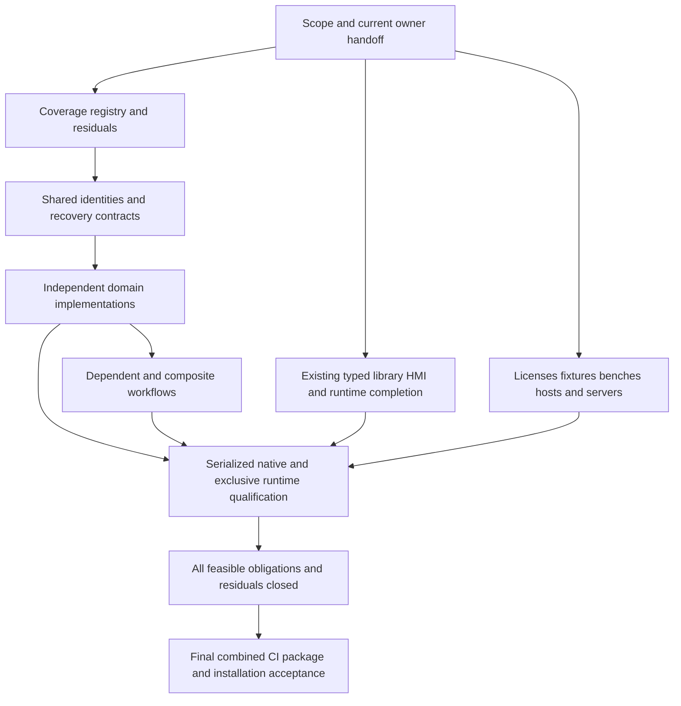

# TIA MCP release obligations and execution order

**Subsequent execution update:** This document and its JSON retain the pre-wave release audit. The user has since confirmed the old coordinator stopped; this session owns integration. Prompts 02/01/03/06 and the first AC-01 implementation slice are now delivered. Use [current handoffs](active-handoffs-20261015.md) and [wave results](../verification/ac01-planning-wave-20261015.md) for those newer states; original acceptance/evidence judgments below remain unchanged.

**27 October 2026 update:** Host-only runs now verify 65 offline features: VCI (D01), translation review (D03), OPC UA NodeSet (D04), AutomationML (D05), GRAPH (X06), the offline diagnostic/trace/experiment/UA-diagnostic tools (D17) and the upload tools. Their native parts remain open. Each affected obligation has an `executionNotes` entry in the JSON. The [sweep record](../verification/host-only-qualification-20261027.md) also ranks the remaining offline-reachable work.

Audit date: **15 October 2026, Europe/Berlin**. **1.0 is not ready. Every feasible capability is a release obligation.** This includes the existing plans, all 18 expansion prompts, the additional API roadmap families, and feasible capabilities discovered while closing the API inventory. Missing products, licenses, fixtures, hardware, supported hosts or qualification are blockers, not reasons to remove an obligation. Unresolved feasibility stays open; an impossible route needs an evidence-backed disposition and consideration of supported alternatives.

This scope decision supersedes older wording about optional expansions, selected release packages, reduced PLC-only releases and deferring feasible work beyond 1.0. Delivery can proceed in useful increments, but those increments do not authorize a 1.0 release. Implementing safety tooling is distinct from certifying an application's functional safety. Release scope also does not authorize arbitrary physical operations, external publishing, installations or resuming the recorded native UI pause.

Use the [machine-readable ledger](release-obligations-20261015.json) for all **44 workstreams, 160 catalog feature records, 165 historical checklist items, 18 prompts and 11 blocker groups**. It retains implementation and qualification separately, exact source/evidence references, dependencies, next actions and proposed owner roles. The immutable audit snapshot (`artifacts/release-audit-20261015/current-results.json`) records the inspected files and hashes. Historical line references in that snapshot refer to the pre-edit document bytes.

## Current results

The source contains **87 registered MCP tools, 55 prepared mutation kinds and 160 catalog features**. The catalog labels 57 implemented, 92 partial and 11 not implemented; its qualification labels are 97 verified, 62 unverified and one failed. These are catalog classifications, **not a release completion percentage**. A verified fixture does not close an entire feature family or qualify a later combined binary.

The file audit captured 1,031 source, contract, fixture, test, UI, build and documentation files. All 632 files in the previous roadmap source inventory still matched before these documentation edits. All referenced catalog evidence paths exist. The current `python -B scripts/test_contracts.py` check passed for all 87 tools, 55 mutation kinds and 160 features. No native run, build, simulator initialization, PLC connection or deployment was performed by this audit.

| Workstream | Retain as completed evidence | What still blocks completion |
| --- | --- | --- |
| **L01 Typed LAD/FBD** | 28 standard and 12 advanced-unit cases have scoped native engineering passes. The reference packet covers 38 distinct inputs and 45 blocks, with separate persistence chains. | Twenty-eight candidates remain inactive. Authored-source lineage, new builder effects/preservation/recovery, remaining scope/storage/operand cases, strict insertion IDs and typed runtime remain open. Original c03 cleanup stays failed. |
| **L02 PLC components** | Component05 and component06 first-checkpoint recovery passed separately. | Component07 terminated with `tia_start: AccessDenied` and `detach, owned_process_exit` cleanup failure. Installation preservation, fresh reopen, first-checkpoint recovery for a new successful installation and runtime remain unqualified. Production combined apply stays disabled. |
| **L03 Simulator/runtime** | Latest full attempt: 48 passing cases, 317 steps and 371 assertions. Revised standalone timer family passed all 18 assertions on its recorded build. | Resolve historical zero-address isolation and post-RUN `.info`/card preservation; qualify actual requested-stop; complete one frozen 65-case, 358-step, 478-assertion corpus. Typed/component behavior needs its own exact evidence. |
| **X02 Libraries** | Earlier 63-stage/17-change lifecycle and selected exact version/dependency/source-reuse evidence. | Behavior-changing and breaking releases, broader dependency/reuse/collision/default/cleanup/lifecycle coverage, HMI integration, vendor/upgrade/scale and actual native interruption/multi-resource recovery. |
| **X07/X08 HMI** | Copied bilingual resource/binding/explorer inspection passed; 195 original files and 76 directories preserved. | Clean Classic/Unified compilation, actual bridge archive recovery, full content/profile coverage, preserving production changes, faceplates and visual/runtime acceptance. RT Professional and optional profiles remain prerequisites. |
| **X10 Hardware/remote I/O** | Native07 passes all nine scoped configured-module lifecycle gates, compile/preservation/reopen/recovery and exact cleanup. | Reviewed writable channel and broader hardware/topology profiles. `channelWriteQualified` and `fullRemoteIoRouteQualified` remain false. |
| **L04 Explorer/reviews** | Diamond impact and scoped 1,000-function native evidence; browser and model checks. | Remaining providers/relationships, native/transport/render performance, actual desktop MCP Apps host and final packaged/current-binary acceptance. |
| **D04 OPC UA** | Existing offline library/CLI: 31 managed and nine Python checks plus client-impact and output-preservation checks. | Host/solution/test integration, native target discovery/export/mapping/lifecycle/security/recovery and physical protocol qualification. Do not recreate the parser. |
| **D17 Diagnostics/trace** | Eight tools, 18 offline diagnostic groups, authored fixture mapping and normalized measurement analysis. | Genuine native instance/observability/settings evidence, supported native backend, lifecycle/preservation/recovery and actual event capture. Manual specifications and synthetic analysis do not close acquisition. |
| **L05/L06 Compatibility and release** | Accepted VM/SSH/recovery evidence, retained p17 combined validation and 14 October offline regression over 13 managed suites. | Complete vendor/older-library/scale/profile matrix, hosted CI and final combined source/binary/package/installation acceptance. No blanket VM requalification is required. |

Evidence: typed handoff (`artifacts/p17t/workstream-handoff-02.json`), component07 terminal result (`artifacts/p17n/component-native-07/result.json`), runtime audit (`artifacts/continuation-20261009/runtime06-final-audit.json`), HMI audit (`artifacts/p17h/copy-inspection01-audit.json`), native07 audit (`artifacts/p17n/native07-independent-audit.json`), [OPC UA evidence](../verification/opc-ua-offline-20261014.md), [trace completion audit](../verification/trace-diagnostics-completion-audit-20261014.md), combined validation (`artifacts/p17r/combined-validation-02.json`), later offline regression (`artifacts/trace-diagnostics-full-20261014/regression/result.json`).

### Corrections to stale work orders

- Do not dispatch the old 19-input typed capture again: capture and separate copied persistence are recorded. The failed original cleanup is not converted into a pass.
- Do not redispatch native07's limited remote-I/O lifecycle as unfinished. The next missing scope is writable-channel qualification and broader profiles.
- Component07 is **failed**, not still being qualified. A historical admission receipt does not identify a current owner or authorize another run.
- The old OPC UA report's missing diagnostic catalog registrations are historical. All eight diagnostic tools are now registered and the current contract check passes.
- The OPC UA frozen source manifest matches 60 of 71 current inputs. Eleven shared diagnostic/contract/catalog/document inputs changed; UA-owned implementation files still match. Retain its exact historical pass and validate the combined integration before claiming current-build acceptance.
- The latest diagnostic receipt matches 21 of 22 source hashes; the mismatch is the later AX feasibility document, not diagnostic implementation. Its updated package-unavailability finding must be retained.
- Typed reference captures, ordinary standard engineering, advanced-unit engineering, library lifecycle, timer timing correction and durable simulator-creation work are not all new tasks merely because an older checkbox remains unchecked.
- Existing VM evidence stays accepted. Missing feature-specific remote behavior is a separate obligation; it does not require repeating accepted general VM tests.

The audit rechecked all 15 referenced hashes in the typed handoff and all 15 in the combined validation receipt. It did not rerun those native tests or independently re-audit every raw measurement in every historical receipt.

## Foundations and execution hierarchy

The AC numbers refer to work packages in the [API roadmap](expansion-plans/api-coverage-and-roadmap.md), not the numbered prompt files. F/L/D/X/C identifiers belong to this ledger; D01-D17 and X01-X13 preserve the roadmap family IDs.

| Order | Package | Concrete exit | Parallel work allowed |
| --- | --- | --- | --- |
| **0** | **F00 / AC-00** | This scope decision and current results are recorded. Obtain present owner/file/resource handoffs; keep unknown ownership explicit. | Every read-only domain planning task; prerequisite acquisition planning; existing workstream evidence review. |
| **1** | **F01 / AC-01** | Deterministic public API inventory and semantic registry; each current tool/change maps to implementation/schema/evidence; residual manual/schema/metadata gaps have next checks. | Missing domain plans, independent document models/fakes, existing typed/library/HMI/runtime preparation. |
| **2** | **F02 / AC-02** | Shared exact object/signal/target/program identity and observation contracts; bounded service probes separately qualified. | Independent modules against the agreed contracts. Existing qualification does not wait for every new registry feature. |
| **3** | **F03 / AC-03** | Reuse/extend prepared changes, jobs and journals; resource freshness/effects/recovery contracts; real interruption evidence per new family. | Independent parsers, protocol fakes, fixtures and isolated builds. Shared hooks merge through one integration owner. |
| **4** | **AC-04/05 and domain packages** | Prioritize exact diagnostic signals to a preserving native watch table; continue trace-route resolution separately. Deliver all other feasible domains according to dependencies below. | Multiple implementation streams with separate files; one native TIA queue; exclusive PLCSIM window. |
| **5** | **Composite workflows and missing profile breadth** | Cross-domain identity/preservation/runtime evidence plus all feasible remaining profiles, failure cases and scale. | Pure and file-only work continues while native/bench jobs queue. |
| **6** | **L06 / AC-25** | Every obligation and feasibility residual closed, then final combined regression/CI/package/install evidence. | Release preparation can start earlier; release acceptance cannot. |

Dependencies are integration and workflow dependencies, not a ban on researching or testing pure components early. Do not create a circular wait in which every adapter waits for the entire identity registry to be finished. Agree the needed contract, implement independently, then integrate and qualify the dependent workflow.

The user-prioritized diagnostic workflow is an early useful outcome, not the only release-critical path. Native trace feasibility, HMI prerequisites, runtime preservation, optional products, older versions and external services can independently block 1.0.

## Expansion prompt order and current domain results

Only **00, 04 and 17** currently have their named standalone output plans. The other 15 have scope in the umbrella roadmap but still need their detailed domain plans. All 18 are planning-only prompts; none is an implementation authorization by itself.

| Prompt | Current implementation and qualification | Next work and dependencies |
| --- | --- | --- |
| [00 Coverage roadmap](expansion-prompts/00-api-coverage-and-roadmap.md) | Plan/raw inventory exists; production semantic registry missing. | Continue AC-01; do not repeat the complete initial inventory investigation. Resolve all untriaged operations before release. |
| [01 VCI/Git](expansion-prompts/01-vci-and-git.md) | No dedicated adapter/tool found. | Workspace/mapping/format/companion/directed-sync and external Git workflow; AC-01/02/03. |
| [02 Watch/force tables](expansion-prompts/02-watch-and-force-table-engineering.md) | Signal-manifest foundation exists; native tables missing. | Verify entry API/document grammar, then create/update/readback/preserve/recover an exact diagnostic table. Uses D17 signal contract, **not AX acquisition**. Active force is a distinct feasibility and qualification obligation. |
| [03 Translations](expansion-prompts/03-project-translations.md) | HMI bilingual resources exist; project translation adapter missing. | Lossless keyed XLSX, filtered exports, language/placeholder/stale-key/import semantics; HMI handoff and AC-03. |
| [04 OPC UA](expansion-prompts/04-opc-ua-engineering.md) | Offline implementation and scoped tests exist; native engineering absent. | Integrate existing code; UA-03 and UA-Q00; exact mappings and category mutations; access/security; runtime handoff. |
| [05 CAx](expansion-prompts/05-automationml-cax.md) | No adapter found. | AML inspection/diff/exchange with whole-effect preservation; shared hardware identities with 08. |
| [06 Test Suite](expansion-prompts/06-native-test-suite.md) | Custom harness exists; Siemens Test Suite bridge absent. | Native style/application/system models and jobs, product/license and cancellation semantics. System endpoints depend on 16; application execution shares PLCSIM exclusivity. |
| [07 Software units](expansion-prompts/07-software-unit-lifecycle.md) | Scoped object inspection/edits and unit fixtures exist; lifecycle incomplete. | Create/relation/namespace/publication/templates/move feasibility; typed and library identity/storage handoff. |
| [08 Connections](expansion-prompts/08-communication-connections.md) | HMI endpoint inspection exists; general transport editing missing. | Exact local/partner/resource identities and typed connection lifecycle. Depends on 05 only where AML is used. |
| [09 Online diagnostics](expansion-prompts/09-online-compare-snapshots-upload.md) | Simulator provisioning and offline reviews exist; physical compare/snapshot/upload missing. | Exact CPU/program identity with 12/16; comparison and snapshot export first, then feasible separately qualified mutations. |
| [10 Startdrive](expansion-prompts/10-startdrive.md) | No adapter found. | Exact offline drive/parameter/telegram profiles; coordinate 08/13; qualify live transfer/activation/trace separately. |
| [11 Alarms/ProDiag](expansion-prompts/11-plc-alarms-prodiag.md) | HMI alarms exist; dedicated PLC/ProDiag adapter missing. | Translation contract from 03, exact member/supervision/HMI graph and preserving native lifecycle; runtime effects separate. |
| [12 Web/access](expansion-prompts/12-web-server-access-configuration.md) | Scratch security helpers exist; general web/access adapter absent. | CPU/project/legacy-web/UA role distinctions, apps/certificates/minimum rights; coordinate 04/16 and X03. |
| [13 Motion/TOs](expansion-prompts/13-motion-and-technology-objects.md) | Selected scalar/axis/connected-encoder support and evidence. | Broader family/version/connection/mapping profiles; 10 for connected-drive recipes, not every independent TO profile. |
| [14 Safety/F-I/O](expansion-prompts/14-safety-validation-and-fio.md) | Inspection and narrow comment import only. | Signature/report/activation definitions, exact F-module settings and feasible protected logic routes; hardware, licensed target and specialist bench prerequisites. |
| [15 SiVArc](expansion-prompts/15-sivarc-hmi-generation.md) | Product/API absent in recorded inventory; adapter missing. | Feasibility/acquisition can start now. Generation depends on library/HMI, units and translation contracts; preserve manual edits and qualify regeneration. |
| [16 Physical runtime](expansion-prompts/16-physical-plc-runtime.md) | No physical Web/UA runtime adapter. | Exact sessions/permissions/read/browse/capture/quality/reconnect, then every feasible write/control capability separately. Pure protocol fakes can start before bench availability. |
| [17 Trace diagnostics](expansion-prompts/17-bug-driven-trace-diagnostics.md) | Offline tools pass scoped checks; native workflow incomplete. | Native instance/signal fidelity can progress independently. AX branch needs package/schema and trigger/readback/TIA persistence resolution; no invented Openness trace API. |

### Recommended planning batches

These batches reduce contract rework; they are not hard barriers to parallel read-only research. One writer owns each destination plan. Do not launch another writer for an already-owned plan without a handoff.

| Batch | Parallel planning sessions | Main coordination |
| --- | --- | --- |
| **A first** | **02 + 01 + 03 + 06** | Existing diagnostic signal contract; VCI versus library documents; HMI text ownership; Test Suite versus custom runtime corpus. |
| **B** | **05 + 08 + 07 + 12 + 09 + 16** | Pair 05/08 around hardware; 09/16 around CPU/program identity; 12 with UA/runtime security; 07 with typed/libraries. |
| **C** | **10 + 13 + 11 + 14** | Drive/TO connection contract; translation/alarm/HMI chain; safety-specific hardware/execution scope. |
| **D** | **15** | Consume PLC/library/HMI/translation contracts. Product feasibility and missing-prerequisite work may start before these finish. |
| **Alongside all batches** | **AC-20, AC-21, AC-22, AC-23, AC-24 planning** | These additional language/collaboration/Add-In/version/SDK obligations have no dedicated numbered prompt; create separate detailed plans from the roadmap. |

With three planning slots, begin 02, 01 and 03, then add 06. Keep a separate integration owner coordinating existing 1.0 work and AC-01. These are proposed roles, not claims that particular earlier sessions are still active.

## Additional release obligations beyond the numbered prompts

| Family | Current result | Required next scope |
| --- | --- | --- |
| **X01 Platform/projects** | Existing session/project/identity/capability substrate. | Operation-level copy/upgrade/properties/settings/languages/read-only/compare/custom-identity coverage and lifecycle/failure/scale gates. |
| **X02 Libraries/documents** | Broad partial implementation and selected lifecycle proof. | Complete exact version/dependency/document-category/component/HMI/vendor/scale/interruption requirements. |
| **X03 Security/UMAC/UMC** | Scratch/authentication patterns, not general security completion. | Project/central roles, rights, certificate lifecycle, confidential configuration, syslog/time/access and external-resource recovery. Extend 12. |
| **X04 Native Add-In** | No companion implementation. | AC-22 detailed plan, supported selection/workflow hooks, packaging/permissions and interactive lifetime acceptance. UI pause remains a blocker. |
| **X05 Multiuser/Project Server** | No adapter/qualified server. | AC-21 server/session/lock/marking/commit plan and response-loss reconciliation using a supplied test endpoint. |
| **X06 GRAPH/CFC/DCC/interpreter** | No dedicated semantic adapters. | AC-20 separate document/profile models, no-op roundtrips then exact edits, run-order/dependency/protection/runtime gates. DCC/interpreter coordinate with drives/TOs. |
| **X07 Classic HMI** | Inspection subsets; production changes gated. | Every feasible Basic/Comfort/Advanced/Professional content family, preserving lifecycle and visual/runtime proof. |
| **X08 Unified HMI** | Bilingual resources/bindings/explorer subsets. | Clean prerequisites, full screen/event/dynamic/script/faceplate/resource/logging/audit/OPC/CPM profiles, preserving engineering and visual/runtime. |
| **X09 Teamcenter** | Module recorded; no bridge/server acceptance. | Separate AC-21 Teamcenter plan: search/download, supported checkout/checkin/publication and exact external commit reconciliation. |
| **X10 Hardware/network** | Limited remote-I/O lifecycle passed. | Writable channels; catalog/HSP/GSD, replacement/copy, topology/shared devices/redundancy, coupler/IO-Link/telecontrol/resource/energy profiles. |
| **X11 PLC objects/documents** | Standard source/tag/type/group/raw/typed and selected SIMATIC SD routes. | Exact move/copy/interface/namespace/number/protection/OB/NVT/loadable/system-type/mixed-language operation profiles; broaden L01/07. |
| **X12 Other TIA versions** | V21 worker only. | AC-23 public SDK/version feasibility matrix, then every feasible adapter/update profile with its own loader/conversion/refusal/qualification. Older library upgrades into V21 are separate. |
| **X13 Other Siemens SDKs** | Advanced V8 implemented; other routes unresolved. | AC-24 feasibility and adapter obligations for standard PLCSIM, Automation Tool, ODK, WinCC runtime, AX and additional supported interfaces discovered. |

All 30 roadmap families retain their exact original scope rows in the JSON ledger. “Not found” means no dedicated implementation was found in the inspected source/tool surface; it is not a statement that Siemens has no public route.

## Cross domain acceptance

| ID | Workflow | Dependencies |
| --- | --- | --- |
| **C01** | PLC library component to HMI faceplate/generated screens, preserving initial install and changed-interface update/regeneration. | L02, X02, X07/X08, D03/D07/D15. |
| **C02** | ECAD hardware update to communication/drive/TO impact and preserving rebind. | D05/D08/D10/D13 and X10. |
| **C03** | Secure UA/web engineering to exact physical program/model/permissions, client-impact and migration proof. | D04/D09/D12/D16 and X03. |
| **C04** | Alarm/bug to exact instance/signals, native watch/trace/test, measured event and repeatable before/after diagnosis. | D02/D06/D09/D11/D16/D17. Watch-table branch does not wait for native trace feasibility. |

Passing each component does not automatically qualify these composite workflows. Add independent expected mappings, complete affected-resource preservation and the applicable runtime/visual/security outcomes.

## Parallel execution and ownership

| Work | Execution rule |
| --- | --- |
| Planning, source/API inspection and evidence audits | Parallel, separate output documents/artifact roots. No native launch implied. |
| Pure parsers/models/fakes/fixtures | Parallel after relevant contracts agree; assign disjoint file ownership. |
| Builds and pure tests | Use isolated source snapshots and unique build/output directories. Shared `bin/obj` and changing source snapshots can invalidate results. |
| Host/worker dispatch, shared identities/journal/catalog, solution/project files, central runners and release docs | One integration owner merges changes serially. Other streams supply reviewable changes and evidence. |
| Native TIA qualification | One coordinated admission queue, immutable inputs/binaries, exact owned lifetime and terminal cleanup. |
| PLCSIM | Separate exclusive runtime window after owned engineering work closes. Test Suite and other adapters share it. |
| Physical benches and external services | Explicit target/service owner and permitted operation scope; do not infer permission from release obligation. |

Historical owner labels are useful file boundaries, not current assignments. Confirm typed, library/network, HMI, diagnostics, UA and integration owners before shared edits. No Git metadata exists here; isolated copies/manifests are available, but Git worktrees are not yet an established mechanism.

Practical implementation streams after handoff:

- **Coordinator/coverage:** AC-01, shared contract reviews, serial merges and evidence maintenance.
- **Existing engineering:** typed lineage/builders, components/libraries, HMI prerequisites and hardware profile preparation in separately owned files.
- **Diagnostic tools:** exact signal fidelity and watch-table documents; native trace route remains an explicit external blocker.
- **Independent adapters:** VCI, translation, UA integration, CAx, Test Suite models and protocol fakes with separate files.
- **Prerequisite work:** optional products, fixture provenance, benches, desktop host, collaboration services and additional version/SDK feasibility. Start early because these can delay all later native gates.

Do not schedule new shared/native work around historical session names or PIDs. This audit did not inspect a live coordinator control channel and does not assign native scheduling rights.

## Blockers and smallest resolving actions

| ID | Blocker | Resolving action |
| --- | --- | --- |
| **B01** | Current native ownership; component07 startup/cleanup failure. | Obtain present coordinator handoff and reconcile exact terminal outcome before a new native packet. |
| **B02** | Runtime isolation, post-RUN preservation and requested-stop. | Failure-driven bounded experiment, independent preservation/cleanup, then frozen corpus in exclusive window. |
| **B03** | Native UI pause; clean HMI and bridge recovery prerequisites. | Supplied configured positive templates/public routes; UI work only after explicit resume; qualify bridge retrieval and native visuals separately. |
| **B04** | Optional products/licenses/schemas/device profiles. | Exact per-operation acquisition/installation/license/fixture list; test actual target eligibility. File presence is insufficient. |
| **B05** | Physical CPU/drive bench and program/security identity. | Supply exact nonproduction target, cert/credential and permitted operations; read-first, later action-specific tests. |
| **B06** | Native trace public route and licensed AX package. | TD-AX-01 plus trigger/full-readback/TIA-object interoperability decision, or another documented supported route. |
| **B07** | Real desktop MCP Apps acceptance. | Supported host resource/selection/tool/fallback fixture; browser mocks alone do not close it. |
| **B08** | Vendor, older-library and scale assets. | Permitted independent PLC/PLC-HMI packages and exact upgrade/large-workload manifests. |
| **B09** | Hosted CI and final release provenance. | Intended repository/ref/runners; final combined acceptance, immutable bundle and installation/rollback receipt. |
| **B10** | Project Server/Teamcenter/UMC services. | Supplied isolated endpoint/version/license/account/data, then service-specific qualification. |
| **B11** | Additional TIA/SDK feasibility. | Public version/SDK/operation inventory with supported-route evidence and target prerequisites. |

These are blockers to later work, not questions that must be answered before independent planning or pure implementation continues. No purchase, installation, physical operation or UI resume was performed by this audit.

## Session handoff prompts

For a missing domain plan, use its existing numbered prompt with this preamble:

> Read docs/plans/release-obligations-20261015.md and the corresponding JSON ledger first. Every feasible capability is required before 1.0; missing prerequisites and unknown feasibility remain blockers. Follow planning prompt NN, reuse the completed 00/04/17 work, and write only your domain plan. Record exact operations/profiles, implementation and qualification separately, file ownership conflicts, dependencies, native prerequisites and a concrete next package. Preserve current native scheduling and UI boundaries. Do not implement or launch native work in this planning task.

For AC-01 implementation:

> Implement AC-01-I from the existing API roadmap, using the current release ledger and retained inventory. First establish ownership of new files and coordinator-owned integration files. Build the reproducible metadata-only collector, semantic registry/validators and residual queue; map every tool/change to source/schema/evidence. Keep API presence, implementation, qualification and target availability separate. Use pure tests and isolated outputs; do not launch Siemens or promote native support. Deliver reviewable shared-file integration and the next bounded native-request packets.

For existing workstreams:

> Continue the next action for ledger ID [L01/L02/L03/X07/X08/X10/D04/D17]. Recheck its latest evidence and current owner handoff. Preserve failed originals and accepted exact scopes. Implement remaining work within assigned files; use separate immutable builds. Native work requires current admission and exact cleanup. Report completed gates, remaining blockers and changed hashes back to the ledger. Do not repeat completed capture/lifecycle work or reduce the 1.0 scope.

For the additional roadmap families, use the 00 prompt's required output structure and the relevant AC-20–24 package, with a separate destination under `expansion-plans`. Cover each language, service, version or SDK independently rather than treating one family pass as proof for all siblings.

## Maintaining and closing the ledger

The JSON contains each feature's original catalog record and evidence references, its assigned workstreams, and a next action. Every historical checkbox has a current disposition; original boxes and failed receipts remain unchanged. The ledger's `releaseAccepted: false` is a conservative release gate, not a denial of its recorded completed subscopes. Current person/session ownership remains explicitly unconfirmed.

For each new result, record the exact operation/target/profile, source and binary identities, fixture and independent oracle, observed gate outcomes, untouched-content evidence, recovery and owned cleanup. Update the affected feature/workstream and its dependent composites. Do not replace a native gate with an offline test or infer broad support from a successful neighboring profile.

The collector (`artifacts/release-audit-20261015/collect.py`) can capture another immutable file snapshot using a new `--output` path. The assembly source (`artifacts/release-audit-20261015/assemble_ledger.py`) records the reviewed judgments for this dated ledger; it is not an automatic future-status updater. A future audit should retain this snapshot, read new terminal results, review changed inputs and produce a new dated reconciliation.

The final gate requires **all feasible operations and profiles implemented and independently qualified, every feasibility residual resolved, all required composite/failure/compatibility/scale gates passed, and final combined CI/package/installation evidence**. No complete family-level release acceptance is inferred by this audit. Operation-by-operation semantic review of every public API/manual/schema residual remains AC-01 work; the present audit covers all named plan/prompt/roadmap families and catalog entries without claiming exhaustive public API certification.
