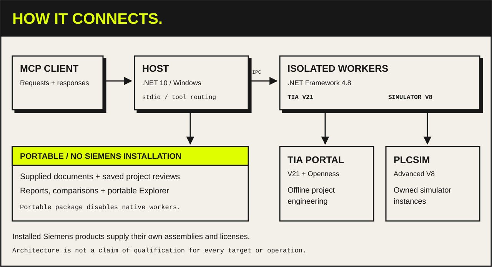

## Components

- **MCP client** talks to the Host over stdio.
- **Host** (`TiaMcp.Host`, .NET 10, Windows) serves the MCP tools, portable document workflows and saved project reviews.
- **OPC UA client** reads scalar, array and matrix values and captures events without TIA, and writes only to an owned PLCSIM server; see the [runtime workflow](https://github.com/Sparkz400/TIA_MCP/blob/main/docs/reference/opcua-runtime.md).
- **Runtime diagnostics** include bounded Web syslog reads and selectable PLCSIM SingleStep capture modes. These additions have offline checks; native qualification remains open. See [CPU diagnostics](https://github.com/Sparkz400/TIA_MCP/blob/main/docs/reference/physical-runtime-sessions.md#cpu-diagnostics) and [capture modes](https://github.com/Sparkz400/TIA_MCP/blob/main/docs/reference/runtime-captures.md#cycle-synchronous-mode).
- **Native workers** (.NET Framework 4.8) run each Siemens call in an isolated process:
  - `TiaMcp.Openness.V21` for TIA Portal V21
  - `TiaMcp.Simulator.V8` for PLCSIM Advanced V8
- **Protected credentials** stay in the Host's per-user store. A worker receives a secret only for one block protection or CPU protection-level apply, sealed to that apply; see the [credential route](https://github.com/Sparkz400/TIA_MCP/blob/main/docs/reference/protected-credentials.md#change-apply-credential-route).
- **TIA Add-In companion** (`TiaMcp.AddIn.V21`, .NET Framework 4.8) runs inside TIA Portal. It sends a project-tree selection to a Host that was started with explicit enrollment, over the Host's one-use pipe challenge. It reads only; one native handoff is verified (`local.addin.companion.20261029`). See the [Add-In companion](https://github.com/Sparkz400/TIA_MCP/blob/main/docs/reference/addin-selections.md#native-companion-build-publish-and-enroll).
- **Project Explorer** is a read-only browser view. It works as a standalone offline HTML snapshot or through a compatible MCP Apps host.

Siemens assemblies are loaded from your installed products and are never redistributed. The portable package disables native workers entirely.

The optional Test Suite adapter also has an exploratory system-test qualification route, with
independent Host/worker admission, owned-simulator endpoint checks and durable recovery. Production
admission stays closed; see [TS-Q03 boundaries](https://github.com/Sparkz400/TIA_MCP/blob/main/docs/verification/testsuite-system-q03-20261103.md).

The engineering worker and its TIA connection are reused across tool calls. Startup checks the worker's saved application identity read-only; registration belongs to explicit setup and approved updates. Separate native helpers are separate applications. See [registration and worker boundaries](https://github.com/Sparkz400/TIA_MCP/blob/main/docs/guides/openness-application-registration.md#why-tia-still-asks).

## Changes are recoverable, not transactional

Native changes follow **prepare → preview → checkpoint → apply → verify**. A change can partially fail across Siemens calls; recovery uses its checkpoint and journal. The public simulation workflow works only on adapter-owned simulator instances: it can download a changed program online, set virtual time and inject interrupts there, but it does not expose physical PLC download, force or CPU control.

A requested compile runs before and after the mutation over the same scope, so
findings that were already in the project, such as another device's errors, are
reported but do not fail a valid change; introduced errors still do. See
[compile verification](https://github.com/Sparkz400/TIA_MCP/blob/main/docs/guides/engineering-workflows.md#compile-verification).

Tag-table XML imports use a declaration-scoped content check so unrelated
inconsistent PLC blocks do not prevent editing a table. Backups, safety boundaries,
stale-preview checks and native readback remain; requested compilation compares
existing diagnostics with the result. This scope does not authorize automatic
whole-project recovery. See the [tag-table import scope](https://github.com/Sparkz400/TIA_MCP/blob/main/docs/guides/engineering-workflows.md#tag-table-import-scope)
for exact coverage and recovery limits.

HMI preservation records export progress before native dispatch and retains failures
without rereading a lost project connection. Classic graphic-list exports are
temporarily blocked; a preservation scope that needs them refuses the change.
See [HMI export containment, diagnostics and disposable-copy tests](https://github.com/Sparkz400/TIA_MCP/blob/main/docs/guides/hmi-engineering.md#temporary-classic-graphic-list-export-containment).
Capture has separate per-file and project-wide capacity bounds; the exact limits
and outstanding native failure are documented in the
[preservation guide](https://github.com/Sparkz400/TIA_MCP/blob/main/docs/guides/hmi-engineering.md#preservation).

The separate `hmi_classic_screen_edit` workflow compares every regular screen of one Classic RT Advanced HMI without exporting graphic lists. It retains checkpoint, compile and exact readback checks, but explicitly excludes shared-resource, other-HMI, PLC and hardware content. This is bounded screen preservation, with profile-wide qualification still unverified. See the [screen editing contract](https://github.com/Sparkz400/TIA_MCP/blob/main/docs/guides/hmi-engineering.md#bounded-classic-screen-editing).

Combined PLC component installation admits only exact combinations with native preservation, reopen and recovery evidence. The qualified FBD OB case and remaining restrictions are listed in the [component workflow](https://github.com/Sparkz400/TIA_MCP/blob/main/docs/guides/plc-library-integration-recipes.md#combined-apply).

Library imports preview dependencies before their selected consumers and refuse cycles before writing. See the [engineering workflow](https://github.com/Sparkz400/TIA_MCP/blob/main/docs/guides/engineering-workflows.md#supported-payloads).

## Support claims

Classic screen import failures have a bounded restore-and-verify path in the open
project. A completed screen edit whose response was lost can also be reconciled
there using independent native evidence. Other mutations retain their existing
recovery requirements. See [screen recovery and timeout handling](https://github.com/Sparkz400/TIA_MCP/blob/main/docs/guides/hmi-engineering.md#screen-failure-recovery-without-closing-tia).
The [local verification record](https://github.com/Sparkz400/TIA_MCP/blob/main/docs/verification/classic-screen-recovery-20261103.md)
distinguishes the native lock-release test from managed recovery checks.

The diagram shows component boundaries, not support for every operation, target or environment. Offline tests, native compilation and runtime qualification are separate claims. Check:

- [Current status](https://github.com/Sparkz400/TIA_MCP/blob/main/docs/STATUS.md)
- [Tool reference](https://github.com/Sparkz400/TIA_MCP/blob/main/docs/reference/tools.md)
- [Engineering coverage](https://github.com/Sparkz400/TIA_MCP/blob/main/docs/reference/engineering-coverage.md)
- `feature_catalog` and `target_capabilities` from the running server

Full detail: [system architecture guide](https://github.com/Sparkz400/TIA_MCP/blob/main/docs/guides/architecture.md).

The [2 November local completion record](https://github.com/Sparkz400/TIA_MCP/blob/main/docs/verification/local-completion-20261102.md) covers dependency-ordered library imports, preserved target paths, the production FBD OB route and the remaining operator/equipment prerequisites.
## Classic screen workflow

The screen workflow adds bounded batching, lease-scoped observations,
native component composition and diagnostic phase progress. The
[verification record](https://github.com/Sparkz400/TIA_MCP/blob/main/docs/verification/classic-screen-workflow-draft-20261103.md)
covers the owned two-screen RT Advanced fixture, including native rollback,
lost-response reconciliation and fresh reopen. Profile-wide and runtime
qualification remain unverified.

Batch reconciliation now requires a receipt for every member, and captured
artifact reads reject symbolic links and junctions. The
[workflow guide](https://github.com/Sparkz400/TIA_MCP/blob/main/docs/guides/hmi-engineering.md#capture-composition-and-batching)
keeps the exact request shape and evidence limits.

Area capture can bundle PLC declarations, HMI member paths and native control
prototypes. Composition supports blank layers, typed faceplate/navigation
constants, multilingual captions and approximate previews. Compiler diagnostics
and terminal progress are handled separately from unknown execution outcomes.
See the [area workflow and evidence limits](https://github.com/Sparkz400/TIA_MCP/blob/main/docs/guides/hmi-engineering.md#area-authoring-and-previews).
The [4 November verification record](https://github.com/Sparkz400/TIA_MCP/blob/main/docs/verification/classic-screen-smoothing-20261104.md)
separates synthetic/Host validation from the outstanding native regression run.

